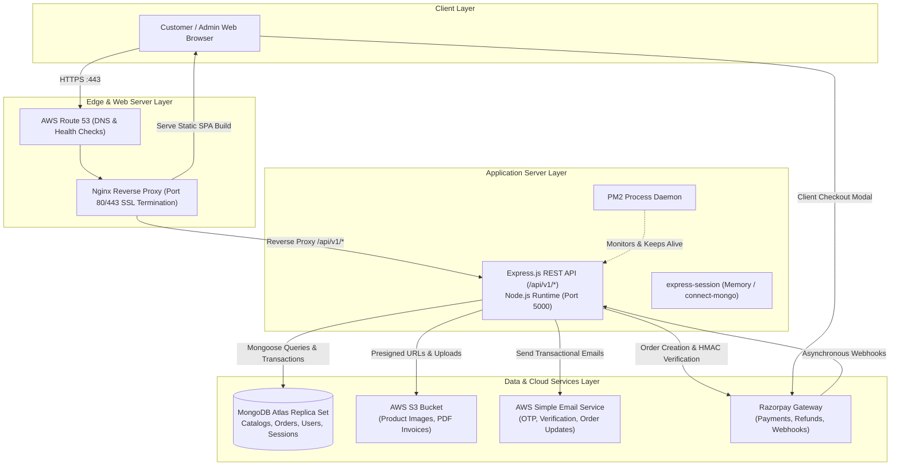

# 02 — High-Level System Architecture

## 1. System Topology Overview
The application is structured as a **Modular Monolith** with a single unified backend API serving a Single Page Application (SPA) frontend. It utilizes cloud-managed services (AWS S3, AWS SES, MongoDB Atlas, Razorpay) to achieve high availability, enterprise-grade security, and production scalability without microservice complexity.



---

## 2. Separation of Responsibilities

### 2.1 Frontend Responsibility (React + Vite)
- **Presentation & Routing**: Renders fast, accessible, and responsive user interfaces using Tailwind CSS and React Router.
- **Client-Side UX & State**: Maintains local component state for filters, form inputs (`react-hook-form`), interactive modals, and global UI state (auth status, cart item count).
- **Client-Side Validation**: Performs immediate instant feedback validation using Zod before requests are dispatched across the network.
- **Payment Modal Launch**: Invokes Razorpay's Checkout.js modal using backend-provided `order_id` and public `key_id`.
- **NEVER Trusted For**: Price calculations, stock availability, discount authorizations, or final order totals.

### 2.2 Backend Responsibility (Node.js + Express)
- **API Gateway & Routing**: Exposes predictable, versioned RESTful endpoints (`/api/v1/*`).
- **Authentication & RBAC**: Enforces session validation, verifies bcrypt password hashes, and protects admin routes via middleware.
- **Business Logic & Service Layer**: The **sole source of truth** for pricing, coupon discounts, inventory decrements, and order status transitions.
- **ACID Transactions**: Coordinates multi-document MongoDB transactions across orders, stock adjustments, and wallet balances.
- **External Integration Hub**: Orchestrates AWS S3 uploads, AWS SES emails, and Razorpay HMAC signature verifications.

### 2.3 Database Responsibility (MongoDB Atlas)
- **Document Persistence**: Stores unstructured and semi-structured e-commerce data (users, products, embedded variants, cart, addresses).
- **Atomic Operations**: Executes atomic operations (`$inc`, `$push`, `$set`) at the document level to prevent concurrency race conditions.
- **Session Expiration**: Enforces TTL (Time-To-Live) indexes to automatically clean up expired OTP records and inactive customer sessions.
- **High Availability**: Managed 3-node replica set provides automatic failover and data redundancy.

### 2.4 External Services Responsibility

#### AWS S3 (Simple Storage Service)
- **Asset Storage**: Stores user-uploaded product images, category banners, and generated PDF tax invoices.
- **Performance Offload**: Prevents the Node.js process from serving large binary files, freeing up CPU and I/O for API requests.

#### AWS SES (Simple Email Service)
- **Transactional Messaging**: High-reputation email delivery infrastructure for OTP codes, password resets, and order confirmations.
- **Decoupling**: Eliminates blocking the HTTP response thread while waiting for remote SMTP mail handshakes.

#### Razorpay Payment Gateway
- **Card & UPI Processing**: Handles PCI-DSS compliant credit card tokenization, net banking gateways, and UPI payment rails.
- **Webhook Dispatch**: Asynchronously notifies the backend of payment captures, refunds, and failures.

---

## 3. Security Boundary Summary
```
+-------------------------------------------------------------------+
| UNTRUSTED ZONE (Browser / Client)                                |
| - React Components, Redux Store, Client Variables                 |
| - Can be inspected, tampered with, or bypassed by Postman/CURL     |
+-------------------------------------------------------------------+
                               |  HTTPS (Encrypted in transit)
                               v
+-------------------------------------------------------------------+
| TRUSTED ZONE (Express Backend Server)                             |
| - Environment Secrets (JWT/Session Secret, AWS Keys, Razorpay Secret) |
| - Recomputes all totals, checks DB stock, executes transactions   |
| - httpOnly, Secure, SameSite Cookie Exchange                      |
+-------------------------------------------------------------------+
            |                          |                     |
            v                          v                     v
     MongoDB Atlas                   AWS S3               Razorpay
  (Isolated Network IP)        (IAM Role Auth)       (HMAC SHA256 Webhook)
```
