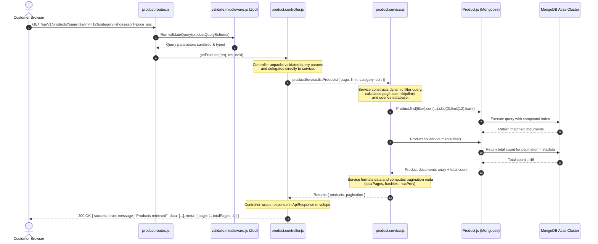

# 04 — Backend MVC & Service Layer Architecture

## 1. Architectural Philosophy: The Service-Oriented MVC
In a standard Express MVC (Model-View-Controller) pattern, controllers often become bloated "fat controllers" containing hundreds of lines of database queries, discount calculations, validation logic, and third-party API calls. 

To maintain clean code standards suitable for senior developer review, this project enforces a **Service-Oriented MVC Architecture**:
1. **Controllers are Thin**: Their only responsibility is reading HTTP requests (`params`, `query`, `body`), delegating to services, and formatting the HTTP response (`status`, JSON).
2. **Services are Rich**: All business logic (pricing, inventory checks, discount calculations, payment verification) lives in standalone, reusable service classes/functions.
3. **Models are Pure**: Mongoose schemas handle document validation, default values, virtual properties, and database indexing.
4. **Middlewares Handle Cross-Cutting Concerns**: Authentication, authorization, input validation, rate limiting, and global error handling are isolated from business logic.

---

## 2. Directory Structure

```
backend/
├── src/
│   ├── config/             # Database connection, AWS S3/SES clients, Razorpay keys, session configuration
│   │   ├── db.config.js
│   │   ├── session.config.js
│   │   ├── s3.config.js
│   │   └── razorpay.config.js
│   │
│   ├── constants/          # Application-wide immutable constants (enums, status codes, messages)
│   │   ├── orderStatus.js
│   │   ├── userRoles.js
│   │   └── httpCodes.js
│   │
│   ├── controllers/        # Pure HTTP request/response handlers (thin controllers)
│   │   ├── auth.controller.js
│   │   ├── product.controller.js
│   │   ├── cart.controller.js
│   │   ├── checkout.controller.js
│   │   ├── order.controller.js
│   │   ├── payment.controller.js
│   │   ├── wallet.controller.js
│   │   └── admin.controller.js
│   │
│   ├── middlewares/        # Express middleware pipeline components
│   │   ├── auth.middleware.js       # Verifies active session (req.session.userId)
│   │   ├── role.middleware.js       # Enforces RBAC ('USER', 'ADMIN')
│   │   ├── validate.middleware.js   # Zod request validation runner
│   │   ├── error.middleware.js      # Global error catcher & sanitizer
│   │   ├── upload.middleware.js     # Multer memory storage for S3 uploads
│   │   └── rateLimiter.middleware.js# IP-based rate limiting
│   │
│   ├── models/             # Mongoose schemas, indexes, and document hooks
│   │   ├── User.js
│   │   ├── OTP.js
│   │   ├── Category.js
│   │   ├── Brand.js
│   │   ├── Product.js
│   │   ├── Cart.js
│   │   ├── Wishlist.js
│   │   ├── Order.js
│   │   ├── Payment.js
│   │   ├── Wallet.js
│   │   ├── WalletTransaction.js
│   │   ├── Coupon.js
│   │   ├── Offer.js
│   │   └── AuditLog.js
│   │
│   ├── routes/             # RESTful API route definitions (versioned under /api/v1)
│   │   ├── index.js        # Aggregator mounting sub-routers
│   │   ├── auth.routes.js
│   │   ├── product.routes.js
│   │   ├── cart.routes.js
│   │   ├── order.routes.js
│   │   ├── payment.routes.js
│   │   ├── wallet.routes.js
│   │   └── admin.routes.js
│   │
│   ├── services/           # Core domain business logic (fat services)
│   │   ├── auth.service.js
│   │   ├── product.service.js
│   │   ├── cart.service.js
│   │   ├── checkout.service.js
│   │   ├── order.service.js
│   │   ├── payment.service.js
│   │   ├── wallet.service.js
│   │   ├── s3.service.js
│   │   └── email.service.js
│   │
│   ├── utils/              # Helper utilities, response classes, PDF builders
│   │   ├── ApiResponse.js
│   │   ├── ApiError.js
│   │   ├── asyncHandler.js
│   │   └── invoiceGenerator.js
│   │
│   ├── validators/         # Zod schemas for incoming request body/params
│   │   ├── auth.validator.js
│   │   ├── product.validator.js
│   │   ├── checkout.validator.js
│   │   └── order.validator.js
│   │
│   ├── app.js              # Express application setup, security middleware wiring
│   └── server.js           # Server bootstrap, database connection, cluster/process listener
│
├── tests/                  # Integration tests with Supertest
└── package.json
```

---

## 3. Detailed Request Flow Example: `GET /api/v1/products`

The diagram below traces an incoming catalog search request through the entire system architecture:



---

## 4. Responsibility Boundaries Summary

| Layer | DO | DO NOT |
| :--- | :--- | :--- |
| **Routes** | Define HTTP paths, methods, and attach middleware stacks. | Write business logic or inline handler functions. |
| **Middlewares** | Intercept requests, verify headers/sessions, validate inputs, catch errors. | Mutate database business entities directly. |
| **Controllers** | Extract `req.body`, `req.params`, `req.query`, invoke services, send `res.json()`. | Query database models directly or calculate business math. |
| **Services** | Execute business calculations, query Mongoose models, invoke third-party APIs (S3/Razorpay). | Touch Express `req` or `res` objects. |
| **Models** | Define schema fields, types, default values, validators, virtuals, and indexes. | Store application state or execute controller logic. |
