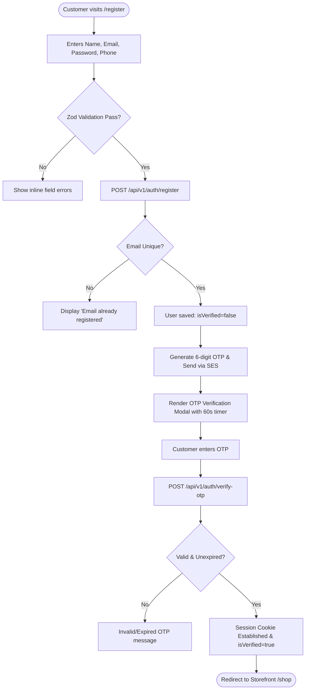
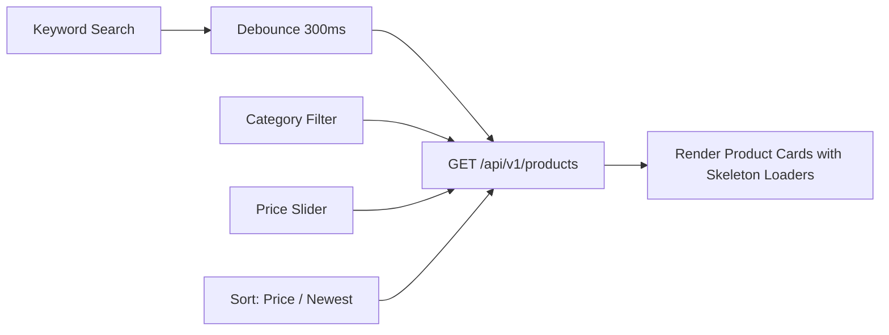
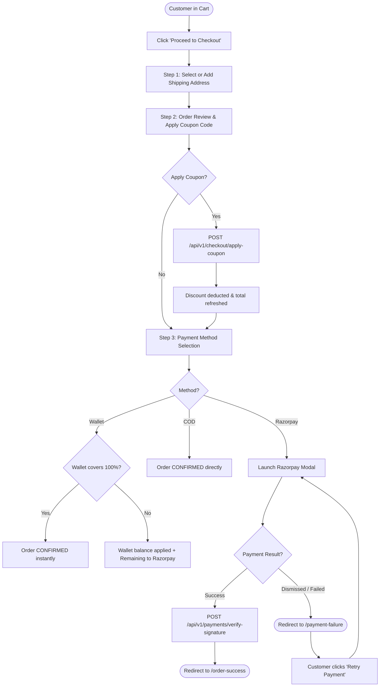
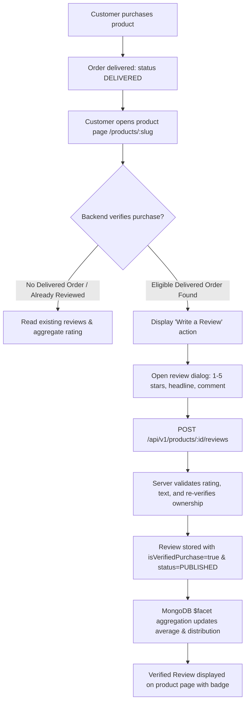

# 05 — End-to-End Customer User Flows

## 1. Overview
This document maps every primary customer journey across the platform from initial onboarding to checkout, payment retry, order tracking, returns, and invoice retrieval.

---

## 2. Onboarding & Account Management Flows

### 2.1 Registration & Verification Journey

### 2.2 Password Recovery & Email Update
- **Forgot Password**: Enters email → Receives 6-digit reset code → Enters OTP + new password → Old sessions invalidated → Prompted to log in.
- **Change Email**: Enters new email → Verification OTP dispatched to *new* email address → Submitting OTP updates email in database.
- **Address Management**: Profile page provides a clean address book. Customers can add multiple addresses (Home, Office) and set a default shipping destination.

---

## 3. Shopping, Discovery & Cart Flows

### 3.1 Catalog Search & Faceted Filtering

### 3.2 Variant Selection & Add-to-Cart
1. Customer clicks product card → Navigates to `/product/:slug`.
2. Selects Variant Attributes (e.g. Size: "9", Color: "Black").
3. Live component updates price tag and stock status ("In Stock" vs "Only 2 Left" vs "Out of Stock").
4. Clicks "Add to Cart":
   - Optimistic UI opens the Cart Drawer immediately.
   - Dispatches `POST /api/v1/cart/items`.
   - Redux `cartSlice` updates badge count in Navbar.

---

## 4. Checkout, Payment & Retry Engine

### 4.1 Multi-Step Checkout Flow

---

## 5. Post-Purchase Fulfillment & Returns

### 5.1 Order Tracking & Cancellation
- Customer navigates to `/my-orders`.
- Orders show live visual progress bar: `CONFIRMED` → `PROCESSING` → `SHIPPED` → `DELIVERED`.
- If order is `CONFIRMED` or `PROCESSING`, an active **"Cancel Order"** button is available.
- Cancellation prompts for reason → Restocks inventory atomically → Issues instant 100% refund into customer's Wallet.

### 5.2 Return Request Flow (Within 7 Days)
1. Order enters `DELIVERED` state.
2. System activates "Request Return" button for exactly 7 days from `deliveredAt`.
3. Customer submits return request with reason (e.g., "Size too small", "Defective item").
4. Order status transitions to `RETURN_REQUESTED`.
5. Admin reviews request in dashboard:
   - If Approved: Order transitions to `RETURNED` → Item collected → Quality check passes → Refund credited to customer wallet.
   - If Rejected: Order reverts to `DELIVERED` with explanation note.

### 5.3 PDF Invoice Download
- Customer clicks "Download Tax Invoice" on order detail view.
- Client triggers `GET /api/v1/orders/:id/invoice`.
- Server streams pre-generated PDF from AWS S3 or generates on-the-fly with complete tax breakdown.

### 5.4 Customer Product Ratings & Verified Reviews Flow

#### Core Distinction:
- **Authentication**: Who the customer is (valid identity session).
- **Authorization**: What the customer is allowed to do (RBAC roles, resource ownership).
- **Verified Purchase**: Backend confirms the customer actually bought and received the product (`DELIVERED` state).

For full architectural details, see [29-ratings-and-reviews.md](./29-ratings-and-reviews.md).

