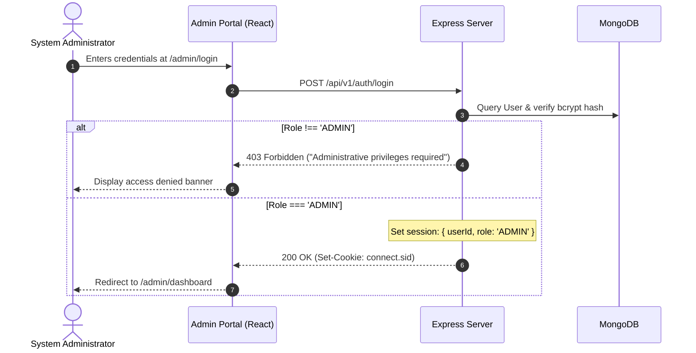
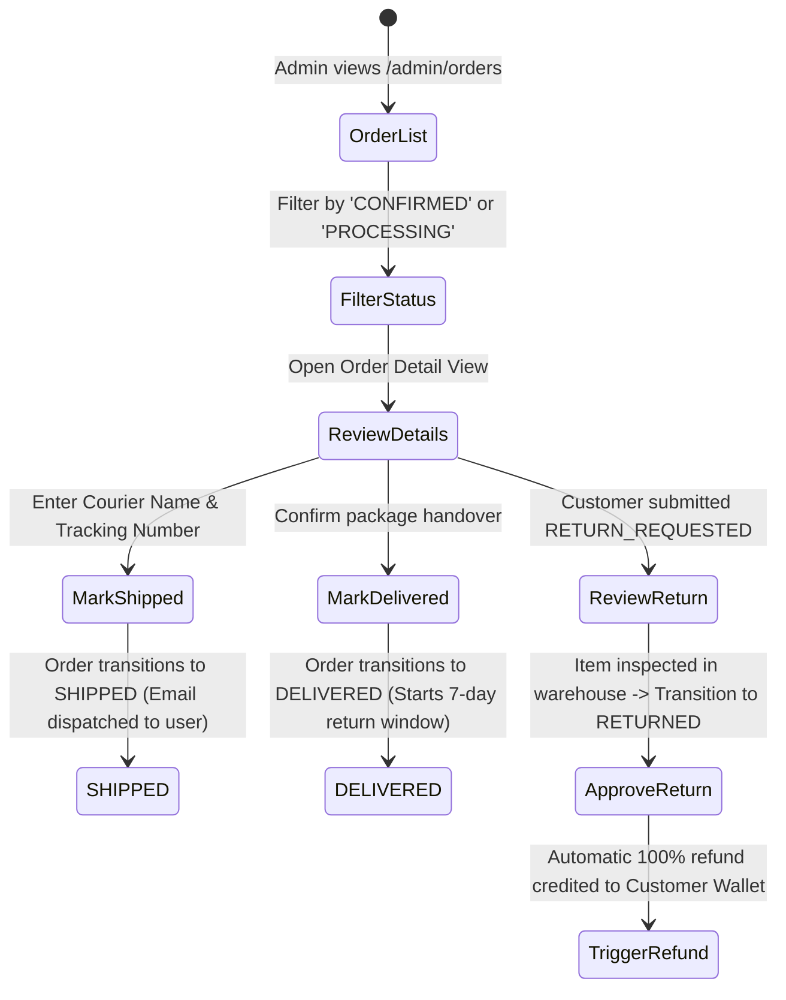

# 06 — Administrator Operations & Governance Flows

## 1. Overview
The Admin Portal is a restricted back-office interface accessible exclusively to users with `role === 'ADMIN'`. It provides management over the product catalog, warehouse inventory, order lifecycle transitions, promotional coupons, customer accounts, and financial analytics.

---

## 2. Admin Operational Workflows

### 2.1 Admin Authentication & Session Guard


---

## 3. Catalog & Warehouse Management

### 3.1 Product & Variant Creation Pipeline
```mermaid
flowchart TD
    StartAdmin([Admin clicks 'Add Product']) --> Form[Fill Name, Slug, Description, Brand, Category, Base Price]
    Form --> AddVariants[Add Variants: SKU, Color, Size, Selling Price, Cost Price, Stock]
    AddVariants --> SelectImages[Select Product Images (up to 6)]
    SelectImages --> Submit[Submit Multipart Form Data]
    Submit --> MulterMem[Multer buffers files in memory]
    MulterMem --> S3Upload[Upload images to AWS S3 & return URLs]
    S3Upload --> SaveDB[Insert Product with Embedded Variants array into MongoDB]
    SaveDB --> Audit[Log action in AuditLog collection]
    Audit --> SuccessToast[Render Success Toast & Redirect to Product List]
```

### 3.2 Inventory Stock Adjustment
- Admin searches for product or SKU.
- Directly updates warehouse stock quantity.
- Triggers atomic update:
  `PATCH /api/v1/admin/products/:id/variants/:varId/stock`
- Prevents negative inventory entries.

---

## 4. Order Fulfillment & Lifecycle Transitions

Administrators possess sole authority to advance fulfillment statuses:



---

## 5. Sales Analytics & Export Engine

### 5.1 Real-Time Analytics Dashboard
- **Revenue KPIs**: Total Gross Revenue, Net Revenue (after coupons/discounts), Total Orders Placed, Average Order Value (AOV).
- **Interactive Visualizations (Recharts)**:
  - 30-Day Sales Volume Trendline.
  - Category Share Donut Chart.
  - Daily Order Volume Bar Chart.

### 5.2 Financial Report Generation (PDF & CSV)
- Admin selects reporting date range: `startDate` and `endDate`.
- Selects export format:
  1. **CSV Export**:
     - Uses `fast-csv` stream pipeline.
     - Streams rows directly to HTTP response: `Content-Type: text/csv`, `Content-Disposition: attachment; filename="sales-report.csv"`.
     - Fields included: Order Number, Date, Customer Name, Items Count, Subtotal, Discount, Wallet Used, Final Paid, Payment Method, Order Status.
  2. **PDF Export**:
     - Built using `pdfkit`.
     - Formats executive summary table, brand logo header, total tax breakdowns, and net revenue calculations.
