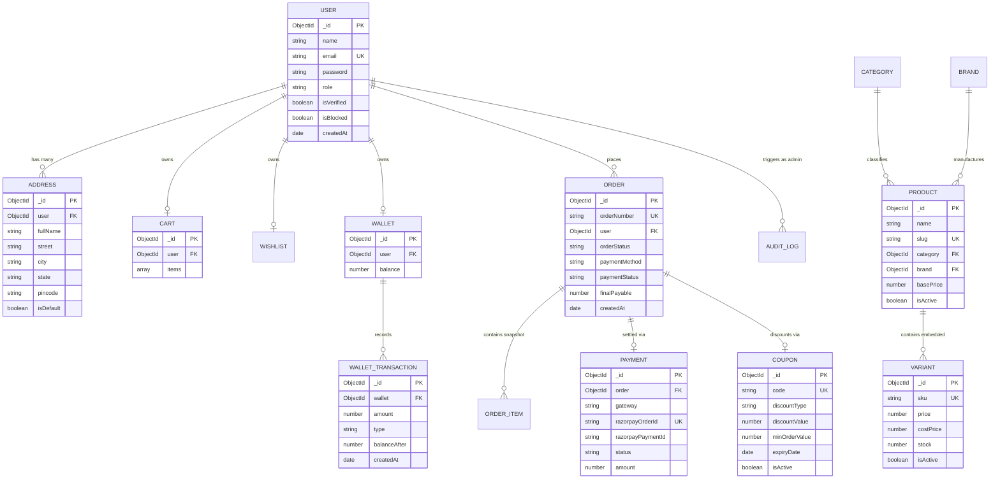

# 08 — Entity-Relationship Diagram & DBML

## 1. Mermaid Entity-Relationship Diagram (ERD)



---

## 2. DBML (Database Markup Language) Specification
*(Paste this snippet directly into [dbdiagram.io](https://dbdiagram.io) or Eraser to visualize interactive database models)*

```dbml
Table users {
  id ObjectId [pk]
  name varchar(50) [not null]
  email varchar(100) [unique, not null]
  password varchar(255) [not null]
  role varchar(10) [default: 'USER', not null]
  isVerified boolean [default: false]
  isBlocked boolean [default: false]
  created_at timestamp [default: `now()`]
}

Table addresses {
  id ObjectId [pk]
  user_id ObjectId [ref: > users.id]
  full_name varchar(100) [not null]
  street varchar(255) [not null]
  city varchar(100) [not null]
  state varchar(100) [not null]
  pincode varchar(10) [not null]
  is_default boolean [default: false]
}

Table categories {
  id ObjectId [pk]
  name varchar(50) [unique, not null]
  slug varchar(60) [unique, not null]
  is_active boolean [default: true]
}

Table brands {
  id ObjectId [pk]
  name varchar(50) [unique, not null]
  slug varchar(60) [unique, not null]
  is_active boolean [default: true]
}

Table products {
  id ObjectId [pk]
  name varchar(120) [not null]
  slug varchar(140) [unique, not null]
  category_id ObjectId [ref: > categories.id]
  brand_id ObjectId [ref: > brands.id]
  base_price decimal [not null]
  is_active boolean [default: true]
  created_at timestamp
}

Table embedded_variants {
  id ObjectId [pk, note: 'Embedded inside products document']
  product_id ObjectId [ref: > products.id]
  sku varchar(50) [unique, not null]
  price decimal [not null]
  cost_price decimal [not null]
  stock int [not null]
  is_active boolean [default: true]
}

Table orders {
  id ObjectId [pk]
  order_number varchar(40) [unique, not null]
  user_id ObjectId [ref: > users.id]
  order_status varchar(30) [not null]
  payment_method varchar(20) [not null]
  payment_status varchar(20) [not null]
  final_payable decimal [not null]
  created_at timestamp
}

Table payments {
  id ObjectId [pk]
  order_id ObjectId [ref: - orders.id]
  razorpay_order_id varchar(100) [unique, not null]
  razorpay_payment_id varchar(100)
  status varchar(20) [not null]
  amount decimal [not null]
  created_at timestamp
}

Table wallets {
  id ObjectId [pk]
  user_id ObjectId [ref: - users.id]
  balance decimal [default: 0]
}

Table wallet_transactions {
  id ObjectId [pk]
  wallet_id ObjectId [ref: > wallets.id]
  amount decimal [not null]
  type varchar(20) [not null]
  balance_after decimal [not null]
  created_at timestamp
}

Table coupons {
  id ObjectId [pk]
  code varchar(20) [unique, not null]
  discount_type varchar(20) [not null]
  discount_value decimal [not null]
  min_order_value decimal [default: 0]
  expiry_date timestamp [not null]
  is_active boolean [default: true]
}
```
