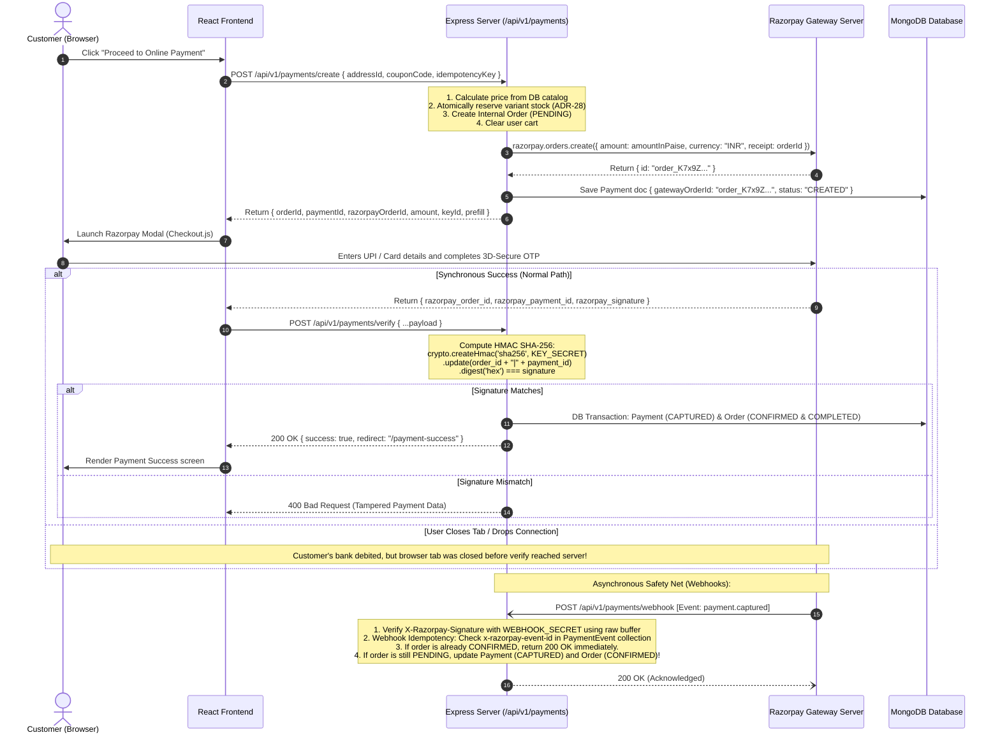
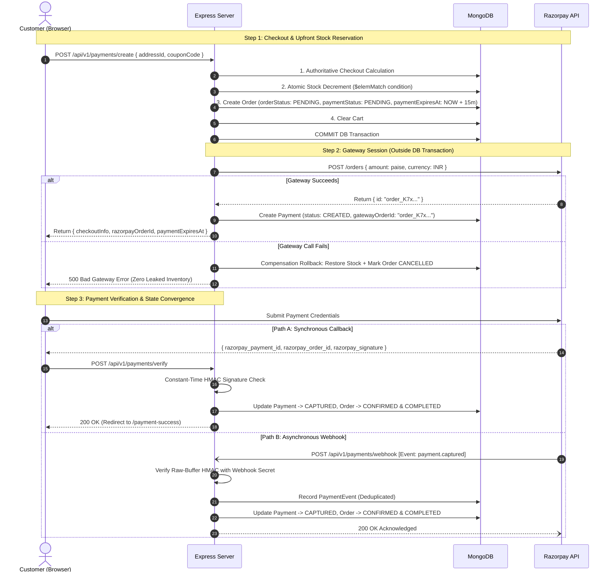
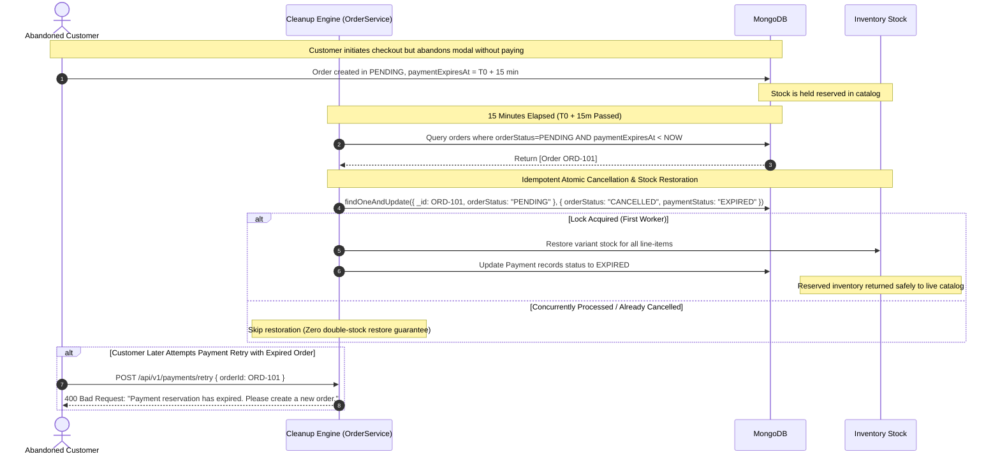
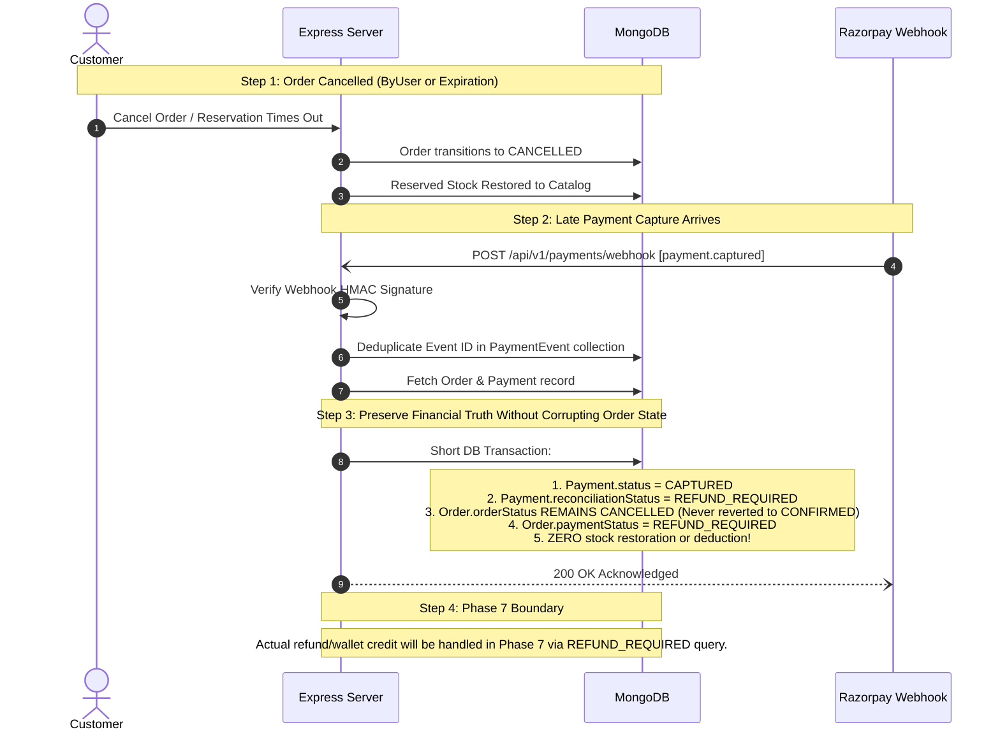

# 13 — Razorpay Payment Architecture & Webhook Synchronization

## 1. High-Level Gateway Architecture
Payment integration is the most high-risk component of any commercial platform. A single security flaw can result in inventory theft or financial fraud.

### The Golden Rule of Payment Security
> **The frontend client must NEVER know the payment secret, and must NEVER specify the payment amount to Razorpay.**
> - The backend calculates the exact authoritative amount from verified database catalog prices.
> - Stock is reserved upfront during internal order creation (ADR-28) to prevent overselling.
> - The backend issues an authenticated `orders.create` API call directly to Razorpay.
> - Razorpay returns a `razorpay_order_id`, which the frontend uses solely to open the visual checkout modal.
> - A payment is **NEVER** marked successful based on client callback claims alone. The backend must mathematically verify the HMAC SHA-256 signature using constant-time comparison or receive a verified webhook event before fulfilling the order.

---

## 2. Dual-Path Synchronization Sequence Diagram



---

## 3. Entity Distinction Matrix

| Concept | Definition & Authority | Storage Location |
| :--- | :--- | :--- |
| **Internal Order** | The primary business contract representing purchased line-items, prices, shipping address, and fulfillment lifecycle (`PENDING` -> `CONFIRMED` -> `DELIVERED`). | MongoDB `orders` collection |
| **Razorpay Order** | Ephemeral gateway session representing an intent to collect a specific amount in paise (`order_xxx`). Created by backend API call. | Razorpay Gateway Servers |
| **Razorpay Payment** | The banking authorization attempt generated when the customer submits their credentials (`pay_xxx`). | Razorpay Gateway Servers |
| **Internal Payment Record** | Durable record capturing the relationship between an Internal Order, the Razorpay Order, the gateway payment ID, and the cryptographic verification state. | MongoDB `payments` collection |

---

## 4. Comprehensive Edge-Case Matrix

| Failure / Edge Scenario | System Response & Resolution Strategy |
| :--- | :--- |
| **1. Payment succeeds at bank, but user closes browser tab before reaching verify API.** | **Webhook Reconciliation**: Razorpay delivers `payment.captured` webhook within 15–30 seconds. Server validates webhook signature using the raw body buffer, finds the order in `PENDING`, marks it `CONFIRMED` and `COMPLETED`. When the user logs back in, their order appears safely in "My Orders". |
| **2. Payment succeeds, but verify API network call times out.** | **Idempotent Webhook + Order Status Polling**: The frontend displays a brief verification spinner. If timeout occurs, the frontend queries `GET /api/v1/payments/order/:orderId`. By this time, either the verify request was processed or the webhook arrived. |
| **3. Customer payment is declined (insufficient bank funds / wrong OTP).** | **`FAILED` State**: Payment and Order payment status are marked `FAILED`. Reserved items remain preserved. The user is redirected to `/payment-failure` with an active "Retry Payment" button. |
| **4. Customer clicks "Retry Payment".** | **Existing Order Reuse**: Rather than making the user re-navigate the store or rebuild their cart, `POST /api/v1/payments/retry` generates a fresh `gatewayOrderId` attached to the *existing* order, seamlessly relaunching the modal. |
| **5. Razorpay webhook is delivered twice.** | **Event ID Deduplication Guard**: Every webhook checks `x-razorpay-event-id` against the `PaymentEvent` collection. If already processed, the handler logs an idempotency hit and returns HTTP `200 OK` immediately without repeating state transitions. |
| **6. User attempts payment signature forgery.** | **Constant-Time Verification**: Server uses `crypto.timingSafeEqual` to verify the generated HMAC against the client signature, preventing timing attacks and rejecting tampered requests. |
| **7. Webhook arrives out of order.** | **State Machine Transition Guard**: A late `payment.captured` webhook will NEVER revert an order that is already in a terminal state like `CANCELLED` or `DELIVERED`. |

---

## 5. Razorpay Signature Verification Code Contracts

### 5.1 Client Payment Callback Verification
```javascript
const crypto = require("crypto");

function verifyRazorpaySignature({ orderId, paymentId, signature, secret }) {
  const payload = `${orderId}|${paymentId}`;
  const generatedSignature = crypto
    .createHmac("sha256", secret)
    .update(payload)
    .digest("hex");

  const generatedBuffer = Buffer.from(generatedSignature, "utf-8");
  const receivedBuffer = Buffer.from(signature, "utf-8");

  if (generatedBuffer.length !== receivedBuffer.length) {
    return false;
  }

  return crypto.timingSafeEqual(generatedBuffer, receivedBuffer);
}
```

### 5.2 Webhook Raw Buffer Signature Verification
```javascript
function verifyWebhookSignature({ rawBodyBuffer, signature, webhookSecret }) {
  const generatedSignature = crypto
    .createHmac("sha256", webhookSecret)
    .update(rawBodyBuffer)
    .digest("hex");

  const generatedBuffer = Buffer.from(generatedSignature, "utf-8");
  const receivedBuffer = Buffer.from(signature, "utf-8");

  if (generatedBuffer.length !== receivedBuffer.length) {
    return false;
  }

  return crypto.timingSafeEqual(generatedBuffer, receivedBuffer);
}
```

---

## 6. Comprehensive Payment & Stock Reservation Flow



---

## 7. Reservation Expiration Flow (Preventing Permanent Inventory Lock)



---

## 8. Financial Reconciliation Flow (Payment Captured After Order Cancellation)



---

## 9. Explicit Payment State Transition Map

```
                  ┌───────────────┐
                  │    CREATED    │
                  └───────┬───────┘
          ┌───────────────┼───────────────┬───────────────┐
          ▼               ▼               ▼               ▼
    ┌───────────┐   ┌───────────┐   ┌───────────┐   ┌───────────┐
    │AUTHORIZED │   │  FAILED   │   │ CANCELLED │   │  EXPIRED  │
    └─────┬─────┘   └─────┬─────┘   └─────┬─────┘   └─────┬─────┘
          │               │               │               │
          │ (Verify/WH)   │ (Late capture)│ (Late capture)│ (Late capture)
          ▼               ▼               ▼               ▼
    ┌───────────────────────────────────────────────────────────┐
    │                         CAPTURED                          │
    │  (If Order is CANCELLED -> reconciliation: REFUND_REQUIRED)│
    └──────────────┬─────────────────────────────┬──────────────┘
                   │                             │
                   ▼ (Full Refund)               ▼ (Partial Refund)
    ┌───────────────────────────┐   ┌───────────────────────────┐
    │         REFUNDED          │   │    PARTIALLY_REFUNDED     │
    └───────────────────────────┘   └─────────────┬─────────────┘
                                                  │ (Balance cleared)
                                                  ▼
                                    ┌───────────────────────────┐
                                    │         REFUNDED          │
                                    └───────────────────────────┘
```

---

## 10. Phase 7 Gateway Refunds & State Mapping

### 10.1 Application Payment State vs Razorpay Gateway State
Do not blindly copy vendor states into the internal model. The table below outlines the exact mapping:

| Razorpay Gateway State | Application Payment State | Semantics in System |
| :--- | :--- | :--- |
| `created` | `CREATED` | Gateway order created, client modal not yet authorized. |
| `authorized` | `CAPTURED` | In our auto-capture architecture, authorized payments are captured immediately. |
| `captured` | `CAPTURED` | Payment successfully captured and verified. Charge intake terminal. |
| `failed` | `FAILED` | Gateway transaction failed or declined by card network/bank. |
| `refunded` (full) | `REFUNDED` | Entire captured amount has been refunded back to original funding source. |
| `refunded` (partial) | `PARTIALLY_REFUNDED` | Portion of captured amount returned; additional refunds permitted up to cap. |
| *N/A (App-only)* | `EXPIRED` | 15-minute payment reservation window elapsed; inventory safely released. |
| *N/A (App-only)* | `CANCELLED` | Customer or admin cancelled order before payment completed. |

### 10.2 Domain Separation: Order vs Payment vs Wallet vs Refund
- **Order**: What the customer purchased (items, quantities, price summary, delivery address, shipping status).
- **Payment**: How the order was paid (gateway, amounts in paise, verification state, reconciliation status).
- **Refund**: Money returned against a captured online payment via Razorpay rails back to original source.
- **Wallet**: Customer's internal stored-value account (promotional rewards, goodwill compensation, admin credits).
- **WalletTransaction**: An immutable append-only ledger entry tracking internal wallet balance movements.

### 10.3 Monetary Representation in Integer Minor Units (Paise)
- All financial calculations, storage schemas, and API arguments operate in **integer minor units (paise: ₹1 = 100 paise; ₹1000 = 100000 paise)**.
- `payment.amount` is stored in integer paise.
- `payment.committedRefundPaise` tracks capacity reserved for pending/processed refunds in integer paise.
- `refund.amount` is stored in integer paise (`validate: Number.isInteger`).
- All calculations are strictly:
  $$\text{maxRefundablePaise} = \text{capturedAmountPaise} - \text{committedRefundPaise}$$
- No division or multiplication by 100 occurs inside backend services or database layers. Conversion to rupees happens strictly at user presentation boundaries.

### 10.4 ADR-32: Refund Concurrency & Pre-Gateway Capacity Reservation
To prevent concurrent refund requests from over-refunding a captured payment (e.g. two parallel ₹700 refund requests on a ₹1000 payment), the system implements an atomic conditional reservation pattern on `Payment`:
```javascript
const updatedPayment = await Payment.findOneAndUpdate(
  {
    _id: payment._id,
    $expr: {
      $lte: [
        { $add: ["$committedRefundPaise", refundAmountPaise] },
        "$amount"
      ]
    }
  },
  { $inc: { committedRefundPaise: refundAmountPaise } },
  { new: true }
);
```
- If another concurrent request reserved capacity first such that the total would exceed `payment.amount`, `updatedPayment` returns `null`, and the service immediately aborts with HTTP 400 (`Total refund amount exceeds captured payment amount`).
- This guarantees safety on both standalone MongoDB instances and replica set clusters.

### 10.5 ADR-29: Refund Execution Boundary Isolation & Failure Rollback
External Razorpay refund API calls are **strictly executed outside MongoDB database transactions**:
1. **Pre-Gateway Capacity Reservation & Record Creation**:
   - Atomically increment `Payment.committedRefundPaise` by `refundAmountPaise`.
   - Create `Refund` document in `PENDING` state with `idempotencyKey`.
2. **External Gateway Call (Outside DB Transaction)**:
   - Invoke `razorpay.payments.refund(gatewayPaymentId, { amount: refundAmountPaise })`.
3. **On Gateway Success**:
   - Update `Refund` to `PROCESSED` with `gatewayRefundId`.
   - Transition `Payment` status (`REFUNDED` if `committedRefundPaise === amount`, else `PARTIALLY_REFUNDED`).
   - Transition `Order.paymentStatus` (`REFUNDED` or `PARTIALLY_REFUNDED`).
   - If order was `RETURN_APPROVED`, transition `orderStatus` to `RETURNED`.
   - If order was `REFUND_REQUIRED`, transition `payment.reconciliationStatus = "SETTLED"`.
   - Emit `ADMIN_INITIATED_REFUND` structured financial audit log.
4. **On Gateway Failure (Network timeout, 5xx error, gateway rejection)**:
   - Atomically release reserved capacity: `Payment.findByIdAndUpdate(payment._id, { $inc: { committedRefundPaise: -refundAmountPaise } })`.
   - Mark `Refund` document `FAILED` with `failureReason`.
   - Return HTTP 500 error. The order and payment retain their valid state, and the released capacity immediately enables a successful subsequent retry.


