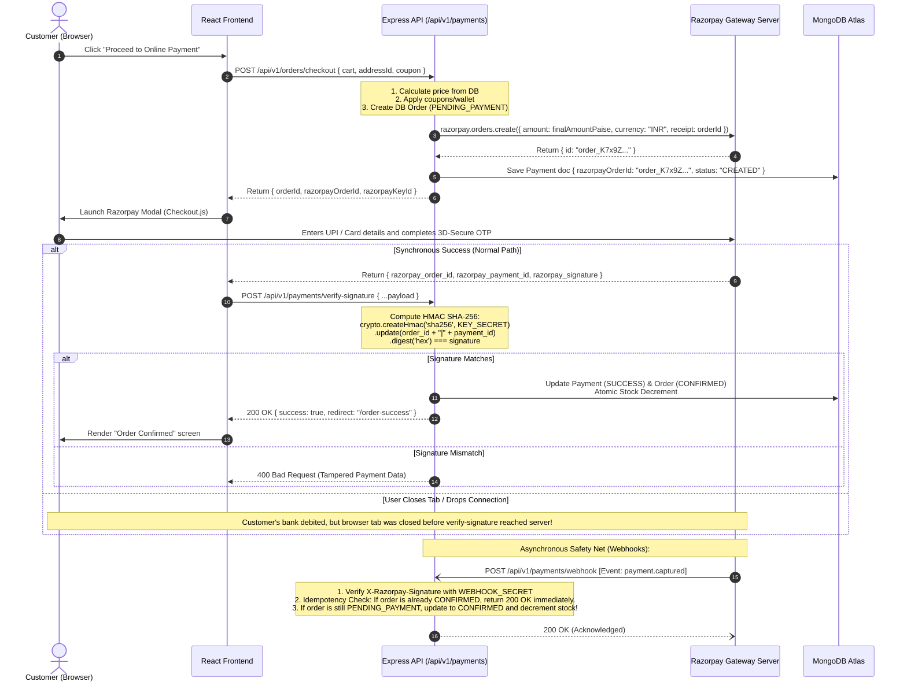

# 13 — Razorpay Payment Architecture & Webhook Synchronization

## 1. High-Level Gateway Architecture
Payment integration is the most high-risk component of any commercial platform. A single security flaw can result in inventory theft or financial fraud.

### The Golden Rule of Payment Security
> **The frontend client must NEVER know the payment secret, and must NEVER specify the payment amount to Razorpay.**
> - The backend calculates the exact amount from verified database prices.
> - The backend issues an authenticated `orders.create` API call directly to Razorpay.
> - Razorpay returns a `razorpay_order_id`, which the frontend uses solely to open the visual checkout modal.
> - A payment is **NEVER** marked successful based on client callback claims alone. The backend must mathematically verify the HMAC SHA-256 signature or receive a verified webhook event before fulfilling the order.

---

## 2. End-to-End Sequence Diagram



---

## 3. Comprehensive Edge-Case Matrix

| Failure / Edge Scenario | System Response & Resolution Strategy |
| :--- | :--- |
| **1. Payment succeeds at bank, but user closes browser tab before reaching verify API.** | **Webhook Reconciliation**: Razorpay delivers `payment.captured` webhook within 15–30 seconds. Server validates webhook signature, finds the order in `PENDING_PAYMENT`, marks it `CONFIRMED`, decrements inventory, and sends confirmation email. When the user logs back in, their order appears safely in "My Orders". |
| **2. Payment succeeds, but verify API network call times out.** | **Idempotent Webhook + Order Status Polling**: The frontend displays a brief verification spinner. If timeout occurs, the frontend queries `GET /api/v1/orders/:id/status`. By this time, either the verify request was processed or the webhook arrived. |
| **3. Customer payment is declined (insufficient bank funds / wrong OTP).** | **`PAYMENT_FAILED` State**: Order status is marked `PAYMENT_FAILED`. Reserved items remain preserved for a 30-minute grace window. The user is redirected to `/payment-failure` with an active "Retry Payment" button. |
| **4. Customer clicks "Retry Payment".** | **Existing Order Reuse**: Rather than making the user re-navigate the store, `POST /api/v1/payments/retry` generates a fresh `razorpay_order_id` attached to the *existing* order, seamlessly relaunching the modal. |
| **5. Razorpay webhook is delivered twice.** | **Idempotency Guard**: Every webhook checks `payment.status`. If the payment record is already marked `SUCCESS`, the handler logs an idempotency hit and returns HTTP `200 OK` immediately without repeating stock decrements or wallet actions. |
| **6. User attempts payment signature forgery.** | **Constant-Time Verification**: Server uses `crypto.timingSafeEqual` to verify the generated HMAC against the client signature, preventing timing attacks and rejecting tampered requests. |

---

## 4. Razorpay Signature Verification Code Contract
```javascript
const crypto = require("crypto");

function verifyRazorpaySignature({ orderId, paymentId, signature }) {
  const generatedSignature = crypto
    .createHmac("sha256", process.env.RAZORPAY_KEY_SECRET)
    .update(`${orderId}|${paymentId}`)
    .digest("hex");

  return crypto.timingSafeEqual(
    Buffer.from(generatedSignature, "utf-8"),
    Buffer.from(signature, "utf-8")
  );
}
```
