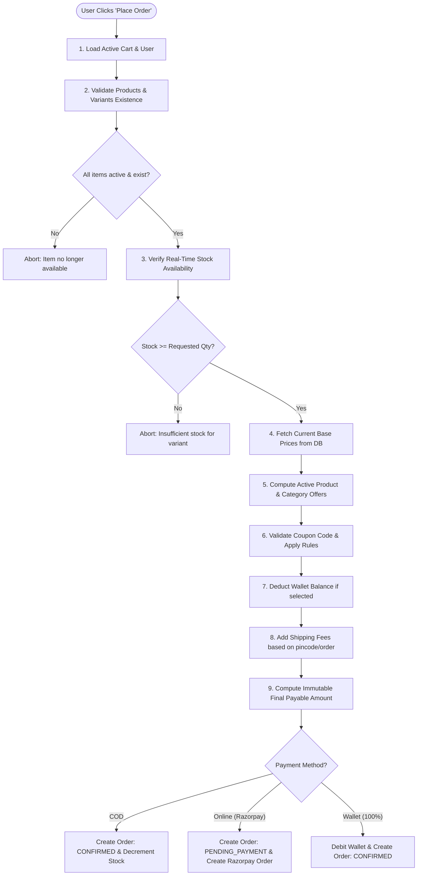

# 14 — Cart & Multi-Stage Checkout Engine

## 1. The Core Law of E-Commerce Security: Never Trust the Client
A fundamental security principle in web engineering: **The client (browser) is an untrusted environment.**

Anyone can open Chrome DevTools, modify JavaScript variables, or send custom HTTP payloads using Postman:
- A malicious actor can modify a product's price from ₹4,999 to ₹1 before submitting the checkout form.
- A user could modify their cart quantity to exceed warehouse stock.
- A user could fabricate a 90% discount code that does not exist in the database.

**Therefore, the backend recalculates and verifies every single parameter at the exact millisecond of checkout.** The frontend only sends intent (`items: [{ productId, variantId, quantity }]`, `addressId`, `couponCode`, `useWallet: boolean`).

---

## 2. Dynamic Shopping Cart Architecture (Phase 4 Foundation)

### 2.1 The Principle of Ephemeral Price Representation
In our database model, the `Cart` collection records only structural intent:
```json
{
  "userId": "64f1...",
  "items": [
    { "productId": "64f2...", "variantId": "64f3...", "quantity": 2 }
  ]
}
```
**Why prices and subtotals are never saved to the Cart document**:
1. **Catalog Drift Resilience**: If an administrator changes a product price from ₹9,999 to ₹8,999, the customer's cart instantly reflects the new price without data synchronization jobs.
2. **Eliminating Price Tampering**: Because the client cannot pass a price to `POST /api/v1/cart/items`, price spoofing is physically impossible.
3. **Stale Stock Detection**: If warehouse inventory drops below the customer's cart quantity (e.g., user added 5 units yesterday, but only 2 units remain today), the retrieval service dynamically flags `staleStock: true` and attaches a warning: `"Only 2 items currently available in warehouse"`.
4. **Wholesale Margin Protection**: The internal wholesale `costPrice` is strictly stripped (`select('-variants.costPrice')`) so business margins are never leaked to the client.

### 2.2 Strict Architectural Boundary: Phase 4 vs Phase 5
- **Adding to Cart DOES NOT Reserve Stock**:
  - Reserving inventory when an item is added to a cart allows malicious users to hoard stock without paying (denial of inventory attack).
  - Therefore, during Phase 4, the cart only verifies availability when items are added or fetched.
  - **Stock reservation is strictly deferred to Phase 5 Checkout**, where stock is decremented atomically when the order is confirmed.

### 2.3 Quantity Limits & Validation Boundaries
- **Minimum Quantity**: 1 (a quantity of 0 triggers item removal).
- **Maximum Per-Item Limit**: 10 units per variant (enforced by Zod schema and service layer to prevent automated bulk hoarding).

---

## 3. Multi-Stage Checkout Pipeline (Phase 5 Architecture)



---

## 3. Step-by-Step Calculation Engine Breakdown

### Step 1 & 2: Existence & Active Status Check
- Queries the `Product` collection for every item in the cart.
- Verifies `product.isActive === true` and the parent `Category.isActive === true`.
- Finds the specific variant inside `product.variants` matching `variantId` and checks `variant.isActive === true`.

### Step 3: Atomic Stock Verification
- Ensures `variant.stock >= item.quantity`.
- If insufficient, checkout halts immediately with a clear error payload: `{ code: 'OUT_OF_STOCK', item: variant.sku, available: variant.stock }`.

### Step 4: Fresh Price Extraction
- Ignores whatever price the frontend displayed.
- Extracts `unitPrice = variant.price` directly from the freshly queried MongoDB document.
- Computes `itemSubtotal = unitPrice * item.quantity`.

### Step 5: Automatic Catalog & Category Offers
- Checks the `Offer` collection for active date-valid offers (`startDate <= now <= expiryDate`).
- If an applicable Category or Product offer exists, the discount is applied to the unit price.

### Step 6: Coupon Application & Boundary Enforcement
- Validates the coupon code:
  1. Does the coupon exist and is `isActive === true`?
  2. Is `now` between `startDate` and `expiryDate`?
  3. Has the global `usageLimit` been reached (`usageCount < usageLimit`)?
  4. Has this specific user exceeded their `perUserLimit`?
  5. Is `subtotal >= minOrderValue`?
- **Discount Calculation**:
  - `PERCENTAGE`: `discount = (subtotal * coupon.discountValue) / 100`. If `coupon.maxDiscountCap` is set, `discount = Math.min(discount, coupon.maxDiscountCap)`.
  - `FLAT`: `discount = coupon.discountValue`.
- **Negative Balance Guard**: `discount = Math.min(discount, subtotal)` (a discount can never make an order total negative).

### Step 7: Wallet Balance Deduction
- If the customer checks "Use Wallet Balance":
  - Fetch real-time `wallet.balance`.
  - `walletDeduction = Math.min(wallet.balance, payableAfterDiscount)`.
  - Remaining amount is charged via Online Payment / COD. If `walletDeduction === payableAfterDiscount`, the order is 100% paid by wallet!

### Step 8: Shipping Fee Calculation
- Free shipping threshold applied (e.g. Free shipping on orders over ₹1,000; otherwise flat ₹99 delivery fee).

### Step 9: Final Total Formulation
$$\text{finalPayable} = (\text{subtotal} - \text{offerDiscount} - \text{couponDiscount}) - \text{walletDeduction} + \text{shippingFee}$$
- All arithmetic is executed in integers (paise) or rounded to 2 decimal places to avoid IEEE-754 floating point precision errors (`0.1 + 0.2 = 0.30000000000000004`).

---

## 4. Race Condition & Concurrency Guard
What happens if two users checkout the last remaining item (`stock = 1`) simultaneously?
We use MongoDB's **atomic conditional decrement**:
```javascript
const updatedProduct = await Product.findOneAndUpdate(
  {
    _id: productId,
    "variants._id": variantId,
    "variants.stock": { $gte: quantity } // Atomic filter precondition
  },
  {
    $inc: { "variants.$.stock": -quantity }
  },
  { new: true, session }
);

if (!updatedProduct) {
  throw new AppError("Item ran out of stock during checkout!", 409);
}
```
Only one query will find `{ "variants.stock": { $gte: quantity } }` evaluate to true. The second query will find 0 matching documents and safely fail, preventing negative stock.
