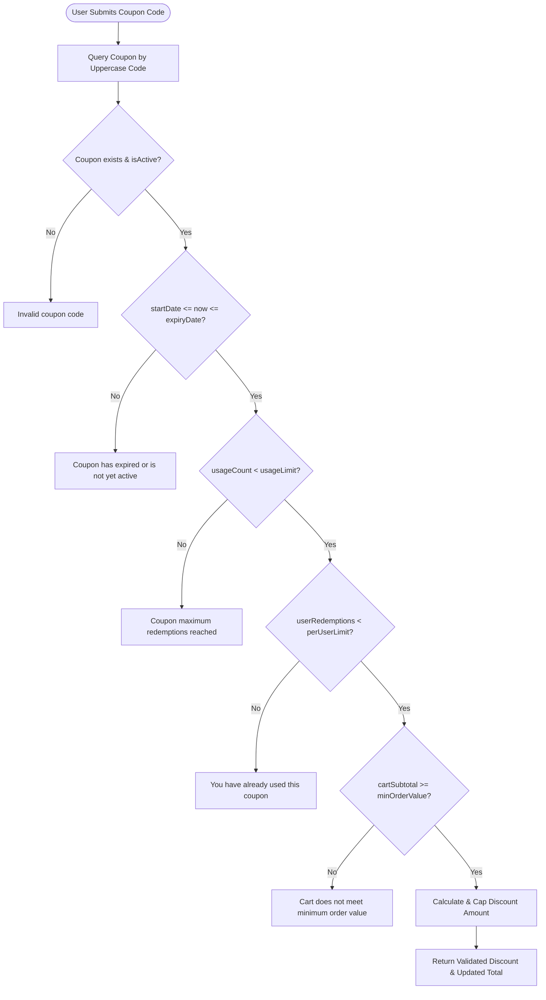

# 15 — Coupon & Offer Calculation Logic

## 1. Architectural Distinction: Offers vs Coupons
Many beginner e-commerce apps confuse **Offers** with **Coupons**. In production systems, they serve two distinct commercial functions:

```
+--------------------------------------------------------------------------+
| OFFERS (Automatic Catalog-Wide Discounts)                                |
| - Applied automatically to product listings and category pages.          |
| - No promo code input required by the customer.                          |
| - Examples: "Flat 20% off all Running Shoes", "Summer Apparel 15% Off".  |
| - Directly reduces the effective selling price of matching items.        |
+--------------------------------------------------------------------------+
                                     +
+--------------------------------------------------------------------------+
| COUPONS (User-Applied Promotional Codes)                                 |
| - Entered explicitly by the customer during checkout in an input box.    |
| - Targeted incentives (e.g. WELCOME100, FESTIVE20, FLASH500).            |
| - Applied to the order subtotal after item-level offers are calculated.  |
| - Governed by strict usage limits, minimum cart sizes, and user quotas.  |
+--------------------------------------------------------------------------+
```

---

## 2. Offer Engine Rules & Priority
1. **Category Offer vs Product Offer**:
   - If both a Category Offer (e.g., 20% off Shoes) and a specific Product Offer (e.g., 25% off Nike Air Max) apply to the same item, the system applies **the higher discount** (Best Deal Rule) to delight the customer without stacking multiple item-level discounts.
2. **Effective Price Calculation**:
   $$\text{discountedPrice} = \text{basePrice} - \left(\frac{\text{basePrice} \times \max(\text{categoryOffer}, \text{productOffer})}{100}\right)$$

---

## 3. Coupon Engine Rules & Validations

When a user submits a coupon code at checkout (`POST /api/v1/checkout/apply-coupon`), the `CouponService` evaluates this verification sequence:



---

## 4. Discount Math & Boundary Protections

### 4.1 Percentage Discount Formula
$$\text{rawDiscount} = \frac{\text{subtotal} \times \text{coupon.discountValue}}{100}$$
If `coupon.maxDiscountCap` exists:
$$\text{discount} = \min(\text{rawDiscount}, \text{coupon.maxDiscountCap})$$

*Example*:
- Subtotal: ₹10,000
- Coupon: 20% off, max cap ₹1,000
- Raw discount: ₹2,000 → Capped discount: ₹1,000. Customer pays ₹9,000.

### 4.2 Flat Discount Formula
$$\text{discount} = \text{coupon.discountValue}$$

*Example*:
- Subtotal: ₹1,500
- Coupon: Flat ₹250 off
- Discount: ₹250. Customer pays ₹1,250.

### 4.3 Universal Negative Total Guard
Under no circumstances may a coupon reduce the payable total below zero:
$$\text{finalPayable} = \max(0, \text{subtotal} - \text{discount})$$
$$\text{discountApplied} = \min(\text{discount}, \text{subtotal})$$
If an administrator accidentally configures a flat ₹500 coupon on a ₹300 order, the discount is strictly bounded at ₹300, keeping `finalPayable = ₹0` (shipping fees still apply if applicable).

---

## 5. Coupon Consumption Concurrency
A coupon redemption is only permanently recorded when the order transitions to `CONFIRMED`. If a user applies a coupon but abandons payment, their `usedBy` count is not permanently consumed, allowing them to try again.
