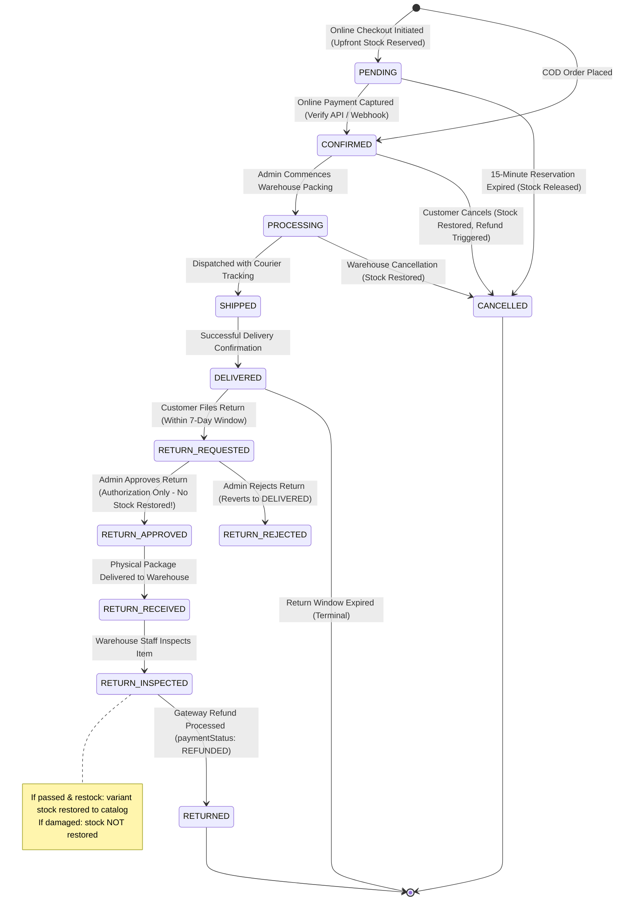

# 16 — Order Lifecycle & Historical Snapshot Design

## 1. The Immutability Principle: Historical Snapshots
In basic tutorials, orders often store foreign keys referencing live product documents (`item: { productId: "..." }`). 

**This is a catastrophic architectural flaw in real-world e-commerce**:
- If an admin modifies a product title next month from "Nike Air Max 2024" to "Nike Air Max 2025", the customer's previous order receipt would retroactively display the wrong product!
- If the price increases from ₹4,999 to ₹7,999, old invoices would recalculate to wrong totals, creating severe tax audit and legal discrepancies.
- If a customer edits or deletes their saved home address, previous delivery records would be corrupted.

### The Solution: Frozen Historical Snapshots
When an order is created, the server writes a **complete, frozen snapshot** into the `items` and `shippingAddress` subdocuments:
```javascript
{
  orderNumber: "ORD-2026-88129",
  userId: ObjectId("..."),
  items: [
    {
      productId: ObjectId("64f1a..."),
      variantId: ObjectId("64f1b..."),
      sku: "NK-AIR90-WHT-09",
      name: "Nike Air Max 90",
      slug: "nike-air-max-90",
      image: "https://res.cloudinary.com/...",
      attributes: { color: "White", size: "9" },
      unitPrice: 4999,
      discountedUnitPrice: 4499,
      quantity: 1,
      itemTotal: 4499
    }
  ],
  shippingAddress: {
    fullName: "Vinesh Kumar",
    phone: "9876543210",
    addressLine1: "Flat 4B, Emerald Towers",
    city: "Bengaluru",
    state: "Karnataka",
    postalCode: "560001",
    country: "India"
  },
  priceSummary: {
    grossSubtotal: 4999,
    offerDiscountTotal: 500,
    netSubtotal: 4499,
    couponDiscount: 0,
    shippingFee: 0,
    grandTotal: 4499
  }
}
```
Even if the product is deleted, renamed, or repriced, the order record remains an immutable, tamper-proof historical fact.

---

## 2. Separation of Concerns: Order Status vs. Payment Status

> [!IMPORTANT]
> **Strict Domain Boundary**
> - **`orderStatus`**: Fulfillment and logistical state of the physical goods (`PENDING`, `CONFIRMED`, `PROCESSING`, `SHIPPED`, `DELIVERED`, `CANCELLED`, `RETURN_REQUESTED`, `RETURN_APPROVED`, `RETURN_REJECTED`, `RETURNED`).
> - **`paymentStatus`**: Financial state of the transaction (`PENDING`, `COMPLETED`, `FAILED`, `EXPIRED`, `REFUND_REQUIRED`, `REFUND_PENDING`, `REFUNDED`, `PARTIALLY_REFUNDED`).
> 
> A payment refund never changes an order's physical history; it updates `paymentStatus` and creates an audited `Refund` entity.

---

## 3. Order State Machine



---

## 4. Return Workflow & 7-Day Window Policy

### 4.1 Return Eligibility Policy
1. Order must be in `DELIVERED` status.
2. Delivery timestamp (`statusHistory` DELIVERED changedAt or order `updatedAt`) must be within **7 calendar days** (`ORDER_RETURN_WINDOW_DAYS = 7`).
3. Order must not already have an active return request.

### 4.2 Multi-Stage Return Workflow & ADR-33 Inventory Timing
> [!IMPORTANT]
> **Stock is NEVER restored upon return approval.**
> Approval is merely administrative permission for the customer to ship the package back. Restoring stock upon approval creates phantom inventory that can be purchased by other customers before physical receipt, or when the returned product arrives broken/unusable.

1. **Customer Return Filing**: `POST /api/v1/orders/:id/return`
   - Customer supplies return `reason`.
   - Transitions `orderStatus = "RETURN_REQUESTED"`.
   - Sets `returnRequest = { status: "REQUESTED", reason, requestedAt: new Date() }`.
2. **Admin Return Review**: `POST /api/v1/admin/orders/:id/return/review`
   - Admin provides `decision` (`APPROVED` | `REJECTED`) and notes.
   - **If APPROVED**: Transitions `orderStatus = "RETURN_APPROVED"`. Sets `returnRequest.status = "APPROVED"`. If payment was captured, sets `paymentStatus = "REFUND_PENDING"`. **Zero stock is restored at this stage.** Emits `ADMIN_APPROVED_RETURN` audit log.
   - **If REJECTED**: Reverts `orderStatus = "DELIVERED"`. Sets `returnRequest.status = "REJECTED"`, recording `rejectionReason`. Emits `ADMIN_REJECTED_RETURN` audit log.
3. **Physical Receipt at Warehouse**: `POST /api/v1/admin/orders/:id/return/receive`
   - Order transitions from `RETURN_APPROVED` to `RETURN_RECEIVED`.
   - Verifies package arrived at warehouse facility.
4. **Warehouse Inspection Gate**: `POST /api/v1/admin/orders/:id/return/inspect`
   - Admin submits `inspectionPassed` (boolean), `restock` (boolean), and `notes`.
   - Transitions `orderStatus = "RETURN_INSPECTED"`.
   - Sets `order.inspectionDetails = { inspectedAt: new Date(), inspectedBy: adminId, passed, restocked, notes }`.
   - **Sellable Inventory Restoration Rule**: Variant stock is restored to the catalog (`StockService.restoreVariantStock`) **strictly if and only if** `inspectionPassed === true` AND `restock === true` AND `!order.inventoryRestored`.
   - Sets `order.inventoryRestored = true` to guard against duplicate inventory restoration.
   - If the item is damaged (`inspectionPassed: false`), stock is **NOT** restored to sellable inventory.
5. **Gateway Refund Settlement**: `POST /api/v1/refunds`
   - Admin issues gateway refund against captured payment.
   - Transitions order from `RETURN_INSPECTED` to terminal `RETURNED`, and `paymentStatus` to `REFUNDED`.

---

## 5. Allowed vs Forbidden State Transitions

| From State | Allowed Target State | Trigger / Actor | Business Side-Effects |
| :--- | :--- | :--- | :--- |
| `PENDING` | `CONFIRMED` | Gateway Webhook / Verify API | Payment marked `COMPLETED`. |
| `PENDING` | `CANCELLED` | Sweeper TTL (15m) / Customer | Releases reserved stock back to catalog. `paymentStatus` marked `EXPIRED`. |
| `CONFIRMED` | `PROCESSING` | Admin | Warehouse begins packing. Cancellation window still open. |
| `CONFIRMED` | `CANCELLED` | Customer or Admin | Immediate atomic stock increment (`+qty`). If online payment captured, triggers gateway refund. |
| `PROCESSING` | `SHIPPED` | Admin | Attaches courier tracking number. Customer cancellation disabled. |
| `PROCESSING` | `CANCELLED` | Admin Only | Stock restored, gateway refund processed. |
| `SHIPPED` | `DELIVERED` | Admin / Courier Delivery | Starts 7-day return countdown. |
| `DELIVERED` | `RETURN_REQUESTED` | Customer | Checks `Date.now() - deliveredAt <= 7 days`. Records return reason. |
| `RETURN_REQUESTED` | `RETURN_APPROVED` | Admin | Authorizes return. Zero stock restored. Sets `paymentStatus: REFUND_PENDING`. |
| `RETURN_REQUESTED` | `DELIVERED` | Admin | Rejects return (e.g., policy violation, expired window). |
| `RETURN_APPROVED` | `RETURN_RECEIVED` | Admin | Package arrived at warehouse. |
| `RETURN_RECEIVED` | `RETURN_INSPECTED` | Admin | Inspects goods. Restores stock only if passed and restock=true. |
| `RETURN_INSPECTED` | `RETURNED` | Refund Service | Gateway refund processed back to customer's original funding source. |

### Strictly Forbidden Transitions (Enforced by OrderService)
- `SHIPPED` → `CANCELLED` *(Package is in transit; customer must request return after delivery)*
- `DELIVERED` → `CANCELLED` *(Item already handed over; must follow formal return workflow)*
- `RETURN_APPROVED` → `RETURNED` *(Must pass RETURN_RECEIVED and RETURN_INSPECTED before settlement)*
- `CANCELLED` → `CONFIRMED` *(A cancelled order cannot be resurrected; user must place a new order)*
- `RETURNED` → `*` *(Terminal state; fulfillment concluded)*
