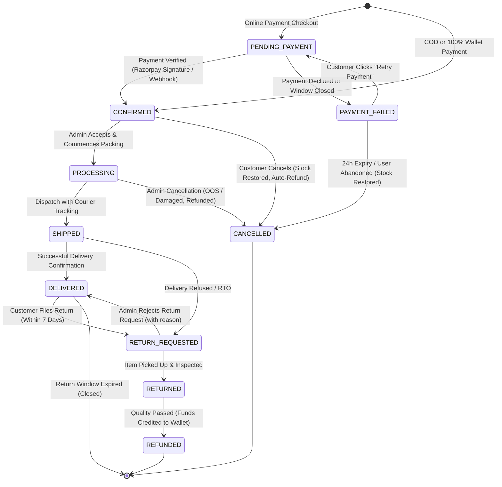

# 16 — Order Lifecycle & Historical Snapshot Design

## 1. The Immutability Principle: Historical Snapshots
In basic tutorials, orders often store foreign keys referencing live product documents (`item: { productId: "..." }`). 

**This is a catastrophic architectural flaw in real-world e-commerce**:
- If an admin modifies a product title next month from "Nike Air Max 2024" to "Nike Air Max 2025", the customer's previous order receipt would retroactively display the wrong product!
- If the price increases from ₹4,999 to ₹7,999, old invoices would recalculate to wrong totals, creating severe tax audit and legal discrepancies.
- If a customer edits or deletes their saved home address, previous delivery records would be corrupted.

### The Solution: Frozen Historical Snapshots
When an order is created, the server writes a **complete, frozen snapshot** into the `items` and `shippingAddress` subdocuments:
```javascript
{
  orderNumber: "ORD-2026-88129",
  user: ObjectId("..."),
  items: [
    {
      product: ObjectId("64f1a..."),     // For tracking/reference
      productName: "Nike Air Max 90",    // Frozen title
      sku: "NK-AIR90-WHT-09",            // Frozen SKU
      attributes: { color: "White", size: "9" },
      price: 4999,                       // Frozen purchase price
      quantity: 1,
      subtotal: 4999
    }
  ],
  shippingAddress: {                     // Frozen shipping destination
    fullName: "Vinesh Kumar",
    phone: "9876543210",
    street: "Flat 4B, Emerald Towers",
    city: "Bengaluru",
    state: "Karnataka",
    pincode: "560001"
  },
  pricing: {
    itemsSubtotal: 4999,
    discountAmount: 500,
    couponCode: "WELCOME10",
    finalPayable: 4499
  }
}
```
Even if the product is deleted, renamed, or repriced, the order record remains an immutable, tamper-proof historical fact.

---

## 2. Order State Machine



---

## 3. Allowed vs Forbidden State Transitions

| From State | Allowed Target State | Trigger / Actor | Business Side-Effects |
| :--- | :--- | :--- | :--- |
| `PENDING_PAYMENT` | `CONFIRMED` | Gateway Webhook / Verify API | Stock permanently reserved, payment marked `COMPLETED`. |
| `PENDING_PAYMENT` | `PAYMENT_FAILED` | Gateway Webhook / Modal Dismiss | Order held in failed state for retry. |
| `PAYMENT_FAILED` | `PENDING_PAYMENT` | Customer "Retry Payment" | Generates fresh Razorpay order ID. |
| `PAYMENT_FAILED` | `CANCELLED` | Automated TTL / Customer | Releases reserved inventory back to catalog. |
| `CONFIRMED` | `PROCESSING` | Admin | Warehouse begins packing. Cancellation window still open. |
| `CONFIRMED` | `CANCELLED` | Customer or Admin | Immediate atomic stock increment (`+qty`). If paid online/wallet, trigger auto-refund to user wallet. |
| `PROCESSING` | `SHIPPED` | Admin | Attaches courier tracking number. Customer cancellation disabled. |
| `PROCESSING` | `CANCELLED` | Admin Only | Stock restored, wallet refund issued. |
| `SHIPPED` | `DELIVERED` | Admin / Courier Webhook | Sets `deliveredAt = Date.now()`. Starts 7-day return countdown. |
| `DELIVERED` | `RETURN_REQUESTED` | Customer | Checks `Date.now() - deliveredAt <= 7 days`. Records return reason. |
| `RETURN_REQUESTED`| `RETURNED` | Admin | Confirms item arrival at warehouse. |
| `RETURN_REQUESTED`| `DELIVERED` | Admin | Rejects return (e.g., damaged by user, tag removed). |
| `RETURNED` | `REFUNDED` | Admin / System | Issues 100% refund transaction to customer's wallet. |

### Strictly Forbidden Transitions (Enforced by OrderService)
- `SHIPPED` → `CANCELLED` *(Package is in transit; customer must request return after delivery)*
- `DELIVERED` → `CANCELLED` *(Item already handed over; must follow formal return workflow)*
- `CANCELLED` → `CONFIRMED` *(A cancelled order cannot be resurrected; user must place a new order)*
- `REFUNDED` → `*` *(Terminal state; no further mutations permitted)*
