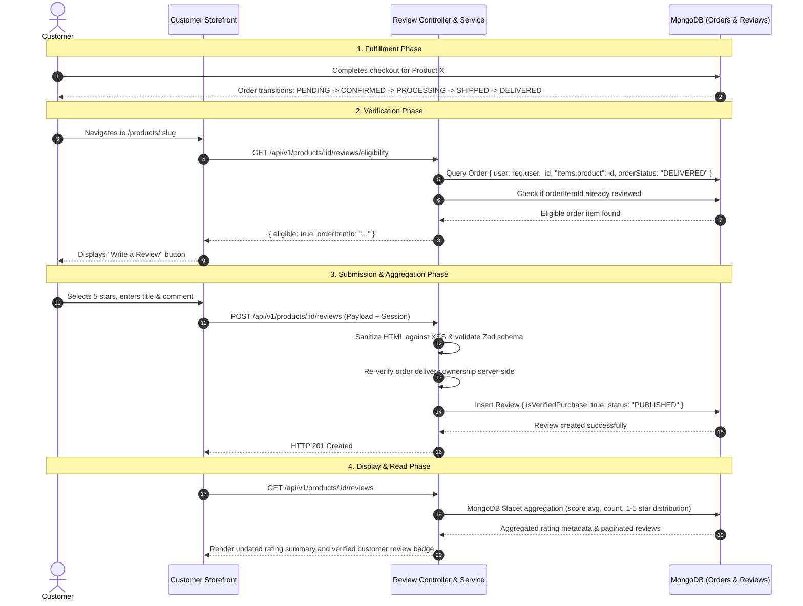

# Ratings & Reviews System Architecture

## 1. Architectural Overview

The **Ratings & Reviews** module enables customers to rate and review products they have bought and received, while providing shoppers with aggregate rating statistics and authentic feedback.

It is structured in full alignment with the Aurora **Modular Monolith + Feature-Based + Layered Architecture**:
- **Domain Layer (`review.model.js`)**: Encapsulates the Mongoose entity schema, validation rules, and composite indexes.
- **Validation Layer (`review.validator.js`)**: Zod schemas validating client inputs before execution.
- **Service Layer (`review.service.js`)**: Core business logic, five-stage purchase verification, aggregation pipelines, IDOR checks, and text sanitization.
- **Controller Layer (`review.controller.js`)**: HTTP envelope handling, parameter extraction, and status code dispatch.
- **Routing Layer (`review.routes.js`)**: Route definitions with authentication, RBAC, and submission rate limiting.
- **Presentation Layer (`features/reviews/`)**: React components implementing star ratings, distribution progress bars, review lists, and interactive review creation/editing modals.

---

## 2. Authentication vs Authorization vs Verified Purchase

A critical architectural distinction is maintained across the review lifecycle:

| Concept | Meaning | Technical Enforcement |
| :--- | :--- | :--- |
| **Authentication** | **Who the customer is.** Confirms identity via session cookies or bearer credentials. | `protect` middleware verifies session validity and populates `req.user`. |
| **Authorization** | **What the customer is allowed to do.** Enforces role-based permissions and resource ownership. | `authorize("CUSTOMER", "ADMIN")` verifies RBAC permissions; service layer confirms `review.user == req.user._id` before permitting mutation (prevents IDOR). |
| **Verified Purchase** | **The customer actually bought and received the product.** Server-side attestation that the review corresponds to a fulfilled transaction. | `ReviewService.verifyPurchaseEligibility` independently scans the database for a `DELIVERED` order containing the specific product and item, never trusting frontend claims. |

---

## 3. Customer Review Flow Lifecycle



### Flow Steps:
1. **Customer purchases product**: Customer places an order containing one or more items.
2. **Order delivered**: Logistics marks `orderStatus: "DELIVERED"`.
3. **Customer opens product page**: Storefront fetches product details and queries the eligibility endpoint.
4. **Backend verifies purchase**: Server verifies that the authenticated customer has a delivered order item for this product that has not already been reviewed.
5. **Customer submits rating/review**: Validated for rating (1–5 integer), headline (3–100 chars), and comment (5–1000 chars).
6. **Review stored**: Persisted with `isVerifiedPurchase: true`, `status: "PUBLISHED"`.
7. **Rating aggregation updated/read**: MongoDB aggregation pipelines immediately reflect updated average ratings and star breakdowns.
8. **Review displayed on product page**: Formatted review appears in public feed with verified badge and owner edit/delete options.

---

## 4. Five-Stage Verified Purchase Rules

To eliminate spoofing, fake reviews, or competitor manipulation, the backend independently enforces five conditions:

1. **Authentication**: Customer must possess an active, valid session (`req.user` must exist).
2. **Order Ownership**: The referenced order must strictly belong to `req.user._id`.
3. **Item Presence**: The referenced order must contain the target `productId`.
4. **Delivered State**: The order status must be strictly `"DELIVERED"`. Unfulfilled orders (`CONFIRMED`, `PROCESSING`, `SHIPPED`, `CANCELLED`) reject review attempts with HTTP 400.
5. **Duplicate Prevention**: Unique index on `orderItemId` guarantees that a customer can review an individual purchased item only once.

---

## 5. REST API Specification

### Customer Endpoints

| Method | Endpoint | Auth | Description |
| :--- | :--- | :--- | :--- |
| `POST` | `/api/v1/products/:productId/reviews` | Customer | Creates a verified customer review. Rate limited via `reviewLimiter`. |
| `GET` | `/api/v1/products/:productId/reviews` | Public | Returns paginated, sorted reviews (`newest`, `oldest`, `rating_desc`, `rating_asc`) and rating summary. |
| `GET` | `/api/v1/products/:productId/reviews/eligibility` | Customer | Verifies whether the authenticated customer can review this product. |
| `PUT` | `/api/v1/reviews/:reviewId` | Customer | Updates rating, title, or comment of own review. |
| `DELETE` | `/api/v1/reviews/:reviewId` | Customer | Deletes own review. |
| `POST` | `/api/v1/reviews/:reviewId/helpful` | Customer | Marks a customer review as helpful (enforces 1 vote per customer, prevents self-voting). |

### Administrator Endpoints

| Method | Endpoint | Auth | Description |
| :--- | :--- | :--- | :--- |
| `GET` | `/api/v1/admin/reviews` | Admin | Lists all reviews with status (`PUBLISHED`/`HIDDEN`), rating, product, and customer filters. |
| `PATCH` | `/api/v1/admin/reviews/:reviewId/status` | Admin | Moderates review visibility (`status: "HIDDEN"` or `"PUBLISHED"`). |
| `DELETE` | `/api/v1/admin/reviews/:reviewId` | Admin | Permanently deletes a review. |

---

## 6. Database Indexing & Aggregation Architecture

### Indexes in `Review` Collection:
- `{ productId: 1, createdAt: -1 }`: Fast retrieval of newest product reviews.
- `{ productId: 1, status: 1 }`: Accelerated lookup of customer-visible published reviews.
- `{ userId: 1, createdAt: -1 }`: Customer profile and history lookup.
- `{ productId: 1, userId: 1 }`: User-product review queries.
- `{ orderItemId: 1 }` (`unique: true`): Strict database-level guarantee preventing duplicate reviews per purchased item.

### Efficient Aggregation:
Instead of loading thousands of documents into application memory, the backend utilizes MongoDB `$facet` and `$group` aggregation pipelines:
```javascript
Review.aggregate([
  { $match: { productId: new mongoose.Types.ObjectId(productId), status: "PUBLISHED" } },
  {
    $facet: {
      stats: [
        {
          $group: {
            _id: null,
            average: { $avg: "$rating" },
            count: { $sum: 1 }
          }
        }
      ],
      distribution: [
        {
          $group: {
            _id: "$rating",
            count: { $sum: 1 }
          }
        }
      ]
    }
  }
]);
```
For catalog listings (e.g. `/shop`, `/products`), `ReviewService.getBatchRatingSummaries` aggregates ratings across all displayed products in a single database round-trip.

---

## 7. Security & Moderation

- **XSS Prevention**: Customer review input is sanitized using HTML entity stripping before saving. React JSX renders text natively escaped.
- **IDOR Protection**: Mutation operations (`PUT`, `DELETE`) load the review document and verify `review.user.toString() === req.user._id.toString()`. Non-owners receive HTTP 403 Forbidden.
- **Sensitive Data Isolation**: Review queries select only safe user fields (`_id`, `name`, `email`). Internal cost prices, password hashes, and billing credentials are never queried or leaked.
- **Admin Visibility Control**: Reviews flagged as `HIDDEN` by administrators are excluded from public storefront APIs while remaining auditable in the Admin Control Console.
