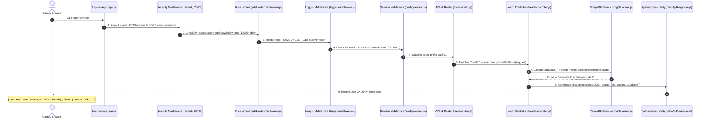

# Phase 1 Report & Pedagogical Architecture Guide

## 1. Executive Summary
Phase 1 establishes the verified runtime foundation for our full-stack MERN e-commerce application. We have constructed a decoupled Express modular monolith backend, validated environment loading, configured MongoDB session persistence, established centralized operational error handling, scaffolded a React 18 + Vite frontend with Tailwind design tokens and Redux Toolkit, and confirmed the health endpoint via Vitest and Supertest.

---

## 2. Tracing a Real Request: What happens when I open `/api/v1/health`?

To understand how our modular monolith actually works, let's trace a real HTTP request from the moment a browser or monitoring tool sends `GET http://localhost:5000/api/v1/health`.

### Step-by-Step Explanation:
1. **Network Entry**: The request hits our Node.js HTTP server on port 5000. Express receives the raw TCP socket data and wraps it into `req` and `res` objects.
2. **Security Headers (Helmet)**: `app.js` runs `helmet()`, injecting crucial headers (`X-Content-Type-Options: nosniff`, `X-Frame-Options: SAMEORIGIN`) preventing MIME-sniffing and clickjacking.
3. **CORS Inspection**: `cors()` inspects the incoming `Origin` header. Since it is either local or matching our configured frontend origin, it permits the request through.
4. **Rate Limiting**: `apiRateLimiter` increments an in-memory hit counter for the caller's IP address. Since the caller has not exceeded the threshold, execution continues.
5. **Request Logging**: Morgan records the incoming method and path, carefully omitting any sensitive parameters.
6. **Session Interceptor**: `express-session` checks the incoming cookie header for `sessionId`. If absent, it initializes a blank session.
7. **Routing**: Express traverses the route tree: matches `/api/v1` in `app.js`, then matches `/health` in `routes/index.js`, delegating directly to `health.controller.js`.
8. **Controller Execution**: `getHealthStatus` queries the non-blocking state of Mongoose (`mongoose.connection.readyState`), measures `process.uptime()`, and packages the payload into `ApiResponse`.
9. **Standardized Response**: The client receives a clean, predictable JSON envelope with HTTP 200 status.

---

## 3. Pedagogical Concepts Breakdown

### 3.1 Backend Architecture

#### Express Application
- **Simple Analogy**: An office building with an entrance reception desk, dedicated floors, and security turnstiles.
- **Technical Explanation**: A minimalist web framework on top of Node.js `http` module providing routing, middleware chaining, and HTTP request/response abstractions.
- **Where it appears**: `backend/src/app.js`.
- **Example**: `const app = express(); app.use(express.json());`
- **Interview Question**: *"What does Express add on top of Node's native `http` module?"*
- **Interview Answer**: *"Node's native `http.createServer` requires manual parsing of URLs, manual body streaming, and complex nested callbacks. Express provides a structured middleware pipeline, semantic routing (`app.get`, `app.post`), automatic content negotiation, and error propagation."*

#### `app.js` vs `server.js` Separation
- **Simple Analogy**: The blueprint of an engine (`app.js`) versus turning the ignition key (`server.js`). You can test the engine blueprint on a testbench without putting it inside a moving car.
- **Technical Explanation**: `app.js` builds the Express instance, registers middlewares, and defines routes without binding to a network port. `server.js` imports `app.js`, connects to the database, and calls `app.listen(PORT)`.
- **Where it appears**: `backend/src/app.js` and `backend/src/server.js`.
- **Example**: In `tests/health.test.js`, we import `app` and pass it to `supertest(app)` without starting a real TCP listener on port 5000.
- **Interview Question**: *"Why should you never call `app.listen()` inside `app.js`?"*
- **Interview Answer**: *"Calling `app.listen()` inside `app.js` tightly couples the application logic to a network port. In integration tests (e.g. Supertest), this causes port collisions when tests run in parallel. Separating them allows tests to execute requests against the Express app in memory without binding ports or requiring live external network listeners."*

#### Middleware Pipeline
- **Simple Analogy**: Airport security checkpoints: ticket check → bag scanner → metal detector → boarding gate. If any checkpoint fails, you are turned away immediately.
- **Technical Explanation**: Functions with signature `(req, res, next)` executed sequentially during the lifecycle of an HTTP request. Calling `next()` advances to the next middleware; passing an argument (`next(err)`) skips directly to the error handler.
- **Where it appears**: `backend/src/middlewares/`.
- **Example**: `const isAuthenticated = (req, res, next) => { if (!req.session.userId) return next(new AppError('Unauthorized', 401)); next(); };`
- **Interview Question**: *"What happens if a middleware neither calls `next()` nor sends a response?"*
- **Interview Answer**: *"The request hangs indefinitely until the client times out, consuming server sockets and causing memory/connection leaks."*

#### API Versioning (`/api/v1`)
- **Simple Analogy**: Book editions. Edition 1 and Edition 2 can sit on the same library shelf simultaneously so older readers aren't stranded.
- **Technical Explanation**: Prefixing routes with `/api/v1` ensures that when breaking contract changes are introduced in the future (`/api/v2`), legacy mobile apps or external integrations continue functioning without interruption.
- **Where it appears**: `backend/src/routes/index.js` mounted at `/api/v1` in `app.js`.

#### Graceful Shutdown
- **Simple Analogy**: Announcing "Last Call" at a cafe, letting seated customers finish their drinks, and locking the doors before turning off the electricity, rather than flipping the main breaker while people are eating.
- **Technical Explanation**: Intercepting process termination signals (`SIGTERM`, `SIGINT`). The server stops accepting new incoming HTTP connections, waits for in-flight requests to complete, flushes pending database writes, disconnects Mongoose cleanly, and exits with code 0.
- **Where it appears**: `backend/src/server.js` in `handleGracefulShutdown()`.
- **Interview Question**: *"Why is graceful shutdown critical in containerized or cloud environments like AWS and Docker?"*
- **Interview Answer**: *"When cloud orchestrators deploy updates or autoscale instances down, they send `SIGTERM`. Without graceful shutdown, active customer checkouts or payment webhook transactions are abruptly aborted mid-write, causing database corruption and orphan records."*

---

### 3.2 Security Foundation

#### CORS (Cross-Origin Resource Sharing)
- **Simple Analogy**: A hotel security guard verifying whether an outside delivery driver is on the authorized guest delivery list.
- **Technical Explanation**: A browser security mechanism that restricts a web application running at one origin (e.g. `http://localhost:5173`) from making AJAX requests to a different origin (e.g. `http://localhost:5000`) unless the server returns permissive `Access-Control-Allow-*` headers.
- **Where it appears**: `backend/src/app.js` using `cors()`.
- **Interview Question**: *"Why can't you use `origin: '*'` when credentials (cookies) are enabled?"*
- **Interview Answer**: *"Browsers explicitly reject cross-origin responses containing cookies or authorization headers if the server sets `Access-Control-Allow-Origin: *`. The origin must be an explicitly declared, non-wildcard domain to protect against unauthorized credential theft."*

#### Helmet
- **Simple Analogy**: Installing bulletproof glass and deadbolts on the entrance of your store.
- **Technical Explanation**: An Express middleware collection that sets well-known HTTP response headers to defend against clickjacking (`X-Frame-Options`), MIME-type sniffing (`X-Content-Type-Options`), and cross-site scripting.
- **Where it appears**: Top of middleware stack in `backend/src/app.js`.

#### Rate Limiting
- **Simple Analogy**: A ticket booth that allows a customer to purchase up to 5 tickets per minute, blocking scalpers who try to buy 500 tickets in a second with automated bots.
- **Technical Explanation**: Limits the number of requests an IP address can dispatch to an endpoint within a given time window (e.g., max 100 requests per 15 minutes).
- **Where it appears**: `backend/src/middlewares/rateLimiter.middleware.js`.

#### Cookies & Session Foundation
- **Simple Analogy**: A waterproof numbered claim ticket given to you at a coat check. The heavy winter coats stay safely in the locked room; you only carry the lightweight paper ticket.
- **Technical Explanation**: The server stores session data in MongoDB (`sessions` collection) and issues an opaque random string cookie (`sessionId`). With `httpOnly: true`, JavaScript cannot access the cookie, completely neutralizing XSS token theft.
- **Where it appears**: `backend/src/config/session.js`.

---

### 3.3 Frontend Foundation

#### Vite
- **Simple Analogy**: Ordering a single fresh slice of pizza on demand versus baking a 20-pizza buffet before anyone is allowed inside the restaurant.
- **Technical Explanation**: Next-generation frontend build tool that leverages native browser ES Modules (ESM) during development, serving code on demand without pre-bundling the entire project. This produces instantaneous server startup and lightning-fast Hot Module Replacement (HMR).
- **Where it appears**: `frontend/vite.config.js`.

#### Redux Toolkit (RTK) Boundary Rule
- **Simple Analogy**: A community announcement board in a town square versus a private shopping list in your pocket. You don't post your grocery list on the town square board.
- **Technical Explanation**: Redux Toolkit manages **global client state** (user authentication status, cart drawer open/close, global alerts). Local component data (input fields, active tab, product filters) belongs in component `useState` or `react-hook-form` to prevent unnecessary component re-renders across the application tree.
- **Where it appears**: `frontend/src/store/index.js` and `frontend/src/store/slices/`.

---

### 3.4 Testing Foundation

#### Unit vs Integration Testing
- **Simple Analogy**: Testing if a lightbulb turns on when connected to a 9V battery (Unit Test) versus testing if the light switch in the kitchen turns on the ceiling fixture through the household wiring (Integration Test).
- **Technical Explanation**: Unit tests isolate pure functions or classes without external dependencies. Integration tests verify that multiple components (e.g., Express router + middleware + controller + response envelope) cooperate correctly.

#### What Supertest Does
- **Simple Analogy**: A mystery shopper who visits your restaurant, orders a meal from the waiter, and checks if the meal was cooked properly and billed accurately according to the menu.
- **Technical Explanation**: Supertest takes an Express `app` instance, simulates incoming HTTP requests in-memory via Node's low-level stream pipeline, and returns status codes, headers, and body payloads for assertion without needing to run a live browser.
- **Where it appears**: `backend/tests/health.test.js`.

---

## 4. Verified Dependency Versions (Post-Review Update)

Following the Phase 1 final review, dependencies were audited and upgraded to modern, supported stable versions without breaking architectural stability:

| Package | Version | Layer | Justification |
| :--- | :--- | :--- | :--- |
| `express` | `^5.2.1` | Backend Core | Modern Express 5 line providing native Promise handling in route handlers and updated HTTP standards. |
| `morgan` | `^1.12.1` | Logging | Stable HTTP request logger for development and production telemetry. |
| `bcryptjs` | `^3.0.3` | Security | Pure JavaScript implementation of bcrypt password hashing, avoiding native C++ build toolchain dependencies on Windows while delivering secure 12 salt rounds. |
| `mongoose` | `^8.9.5` | Persistence | Modern Mongoose 8 ODM with native schema validations and connection management. |
| `express-session` | `^1.18.1` | Session | Secure session middleware for stateful authentication. |
| `connect-mongo` | `^5.1.0` | Session Store | MongoDB session persistence adapter. |
| `vitest` | `^3.2.7` | Backend Test | High-speed ESM-native test runner. |
| `supertest` | `^7.0.0` | Backend Test | HTTP assertion library for testing Express apps without binding ports. |
| `react` | `^18.3.1` | Frontend Core | Industry standard reactive UI component library. |
| `react-dom` | `^18.3.1` | Frontend DOM | DOM renderer for React. |
| `vite` | `^6.0.7` | Frontend Tooling | High-performance frontend build tool and dev server. |
| `tailwindcss` | `^3.4.17` | Frontend Styling | Utility-first CSS framework for atomic design tokens. |
| `@reduxjs/toolkit` | `^2.5.0` | Frontend State | Modern opinionated Redux state management. |

---

## 5. Dual-Probe Health Architecture: Liveness vs Readiness

In cloud environments (such as AWS ECS, EKS, or EC2 Application Load Balancers), a single health endpoint is insufficient. Phase 1 separates health monitoring into two distinct probes:

1. **Liveness Probe (`GET /api/v1/health`)**:
   - **Purpose**: Verifies whether the Node.js process is alive, the event loop is spinning, and the HTTP listener is accepting sockets.
   - **Response**: Always returns HTTP 200 with uptime, timestamp, and PID as long as the Express process is active.
   - **Cloud Orchestrator Action**: If this fails, the orchestrator restarts the container or process.

2. **Readiness Probe (`GET /api/v1/health/ready`)**:
   - **Purpose**: Verifies whether the application has successfully connected to all backing dependencies (MongoDB) and is ready to process customer traffic.
   - **Response**: Returns HTTP 200 if `mongoose.connection.readyState === 1` (`connected`), or HTTP 503 Service Unavailable with `database: "disconnected"` if the database is unreachable.
   - **Cloud Orchestrator Action**: If this fails, the load balancer temporarily stops routing customer traffic to this instance while keeping the process alive to attempt reconnection.
