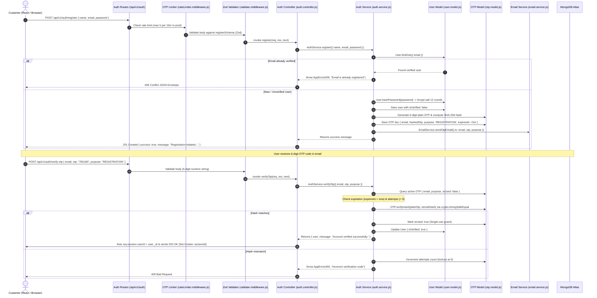

# Phase 2 Report & Pedagogical Authentication Guide

## 1. Executive Summary
Phase 2 establishes the end-to-end authentication, session management, and user governance foundations for our full-stack MERN e-commerce application. 

The backend has been migrated to the current stable **Express 5.2.1** line, dependencies updated, health semantics split into process **Liveness** (`/health`) and dependency **Readiness** (`/health/ready`), and the entire authentication lifecycle (Registration, OTP email verification with SHA-256 and TTL, Login, Logout, Current User `/me`, Forgot Password, Reset Password, Change Password, and Change Email) has been implemented and verified via **25 automated integration tests** against live MongoDB.

---

## 2. Complete Phase 2 Request Flow (Registration to Verification)



---

## 3. Pedagogical Concepts Breakdown (The 17 Core Principles)

### 1. What is authentication?
- **Simple Analogy**: Showing your government passport at airport security to prove **who you are**.
- **Technical Explanation**: The process of validating a claimed identity by comparing submitted credentials (such as an email and password, or a 6-digit OTP) against an authoritative cryptographic record.
- **Where it appears**: `backend/src/modules/auth/auth.service.js` in `login()` and `verifyOtp()`.
- **Actual Example**: `const isMatch = await user.comparePassword(password);`
- **Interview Question**: *"What is the difference between identification and authentication?"*
- **Interview Answer**: *"Identification is claiming an identity (e.g. providing an email `john@example.com`). Authentication is providing cryptographic proof that you are the legitimate owner of that identity (e.g. providing the matching secret password or entering a one-time password sent to that email)."*

---

### 2. What is authorization?
- **Simple Analogy**: The boarding pass that specifies whether your ticket permits you into Economy, Business Class, or the Pilot's Cockpit.
- **Technical Explanation**: The process of determining whether an already-authenticated user has the permissions required to access a specific resource or execute an operation.
- **Where it appears**: `backend/src/middlewares/auth.middleware.js` in `requireRole('ADMIN')`.
- **Actual Example**:
  ```javascript
  if (!allowedRoles.includes(req.user.role)) {
    return next(new AppError("You do not possess the required permissions...", 403));
  }
  ```
- **Interview Question**: *"Why should authorization never be handled solely on the frontend?"*
- **Interview Answer**: *"Frontend code runs in an untrusted client environment. An attacker can use Chrome DevTools, modify JavaScript variables, or send raw HTTP requests using cURL or Postman to bypass frontend UI guards. The backend API must authoritatively enforce role checks on every request."*

---

### 3. What is a session?
- **Simple Analogy**: A numbered claim ticket given to you at a coat check. You don't describe your jacket every time you want it; the coat check attendant looks up your ticket number in their ledger.
- **Technical Explanation**: A server-side state record representing an ongoing authenticated dialogue with a client. The server stores user session data in a database (`connect-mongo`) and provides the client an opaque Session ID.
- **Where it appears**: `backend/src/config/session.js` and `req.session.userId`.
- **Actual Example**: `req.session.userId = user._id; req.session.role = user.role;`
- **Interview Question**: *"What is the main security advantage of session-based authentication over stateless JWTs?"*
- **Interview Answer**: *"Instant revocation. Because session state lives in the database, an administrator can immediately ban a compromised account, or a user can click 'Log out from all devices', and deleting the session document revokes access instantly. Stateless JWTs cannot be revoked until their expiration timestamp without maintaining a server-side denylist, which negates their statelessness."*

---

### 4. What is a cookie?
- **Simple Analogy**: The physical plastic wristband locked onto your wrist at a resort that you cannot alter yourself.
- **Technical Explanation**: A small piece of data sent by the server via the `Set-Cookie` header and stored by the browser. On subsequent requests to the same origin, the browser automatically attaches the cookie in the `Cookie` request header.
- **Where it appears**: Configured in `backend/src/config/session.js` with `httpOnly: true`, `secure: env.isProduction`, and `sameSite: 'lax'`.
- **Interview Question**: *"Why must authentication cookies always be marked `httpOnly: true`?"*
- **Interview Answer**: *"Setting `httpOnly: true` instructs the browser that the cookie must not be accessible via client-side JavaScript (`document.cookie`). If an attacker finds a Cross-Site Scripting (XSS) vulnerability on the site, they are physically prevented from reading or exfiltrating the session cookie."*

---

### 5. How does `connect-mongo` work?
- **Simple Analogy**: A dedicated file clerk who writes all coat-check ticket numbers into a fireproof ledger so that even if the building loses power, nobody's coat ticket is lost.
- **Technical Explanation**: A MongoDB-backed session store for `express-session`. Instead of storing sessions in Node's volatile process RAM (which destroys all active logins on server restart or when scaling horizontally across multiple cluster instances), `connect-mongo` persists serialized session objects directly into a MongoDB `sessions` collection with native TTL indexes.
- **Where it appears**: `backend/src/config/session.js`.
- **Interview Question**: *"What happens to user sessions when using default `MemoryStore` in production?"*
- **Interview Answer**: *"MemoryStore stores sessions in the Node.js process heap. It causes severe memory leaks because it does not clean up expired sessions efficiently, and whenever the server restarts or deploys a new build, every single user is logged out. In multi-instance load-balanced environments, requests bouncing between different servers cannot find their session."*

---

### 6. Why hash passwords?
- **Simple Analogy**: Making a fruit smoothie. Once you blend strawberries, bananas, and milk into a smoothie, it is physically impossible to reverse the process and pull out the original whole strawberry.
- **Technical Explanation**: Passwords must never be stored in plaintext. In the event of a database breach or unauthorized database dump, plaintext passwords expose users across all other websites where they reused that password. A cryptographic hash is a one-way mathematical function that cannot be reversed.
- **Where it appears**: `backend/src/modules/users/user.model.js` in `User.hashPassword()`.
- **Interview Question**: *"Why isn't standard SHA-256 or MD5 sufficient for password hashing?"*
- **Interview Answer**: *"SHA-256 and MD5 were designed to be extremely fast for checksumming large files. Because modern GPUs can compute billions of SHA-256 hashes per second, attackers use precomputed Rainbow Tables and brute-force cracking rigs to invert them in seconds. Password hashing requires intentionally slow, adaptive key-derivation functions like bcrypt."*

---

### 7. Why bcrypt?
- **Simple Analogy**: A bank safe with a time-delay dial. Even if a thief has the combination, the dial forces them to wait 30 seconds per attempt, making it impossible to try thousands of combinations.
- **Technical Explanation**: bcrypt is an adaptive cryptographic hash algorithm based on the Blowfish cipher. It incorporates a **salt** (random data generated per password to defeat rainbow tables) and a configurable **work factor (salt rounds)**. We use 12 rounds, which takes approximately 250–350ms of CPU computation per hash, making mass brute-force attacks computationally and financially unviable for attackers.
- **Where it appears**: `backend/src/modules/users/user.model.js`.
- **Interview Question**: *"What is the purpose of the salt in bcrypt?"*
- **Interview Answer**: *"A salt is a cryptographically random string appended to the password before hashing. It guarantees that two users who choose the identical password (e.g. `Password123!`) will have completely different resulting hash strings in the database, defeating precomputed rainbow table attacks."*

---

### 8. Why hash OTPs?
- **Simple Analogy**: Shredding a physical locker combination into an encrypted barcode that can only verify the right key when scanned, but cannot be read directly by an eavesdropper looking over your shoulder.
- **Technical Explanation**: If an attacker gains read-only access to the database (via a SQL/NoSQL injection vulnerability, backup exposure, or an untrusted intern), storing plaintext 6-digit OTPs allows them to hijack accounts in real-time by intercepting active verification codes. Storing a SHA-256 hash of the OTP (`hashedOtp`) prevents this credential theft.
- **Where it appears**: `backend/src/modules/auth/otp.model.js`.
- **Interview Question**: *"Why is SHA-256 acceptable for OTP hashing while unacceptable for passwords?"*
- **Interview Answer**: *"Unlike passwords, OTPs are short-lived (5-minute TTL) and strictly rate-limited with an attempt counter (max 5 attempts before destruction). An attacker cannot run offline brute-force attacks against a live server because the OTP document self-destructs after 5 incorrect guesses or after 5 minutes."*

---

### 9. What is TTL (Time-To-Live)?
- **Simple Analogy**: Self-destructing paper that dissolves into dust exactly 5 minutes after opening it.
- **Technical Explanation**: A MongoDB feature that automatically deletes documents from a collection after a specific duration or at a specific timestamp. By creating an index on `{ expiresAt: 1 }` with `{ expireAfterSeconds: 0 }`, MongoDB’s background TTL thread purges expired documents automatically every 60 seconds.
- **Where it appears**: `backend/src/modules/auth/otp.model.js`.
- **Actual Example**: `otpSchema.index({ expiresAt: 1 }, { expireAfterSeconds: 0 });`
- **Interview Question**: *"How does MongoDB's TTL index mechanism work internally?"*
- **Interview Answer**: *"MongoDB runs a background thread once every 60 seconds that reads the TTL index and removes documents where the indexed date field is older than the specified duration. Because the thread runs periodically, documents might linger for up to 60 seconds past their expiration time, which is why our application code also enforces `expiresAt > new Date()` synchronously."*

---

### 10. Why use OTP purpose fields?
- **Simple Analogy**: A key tagged "Locker Room Only" that cannot be used to unlock the Manager's Safe, even though both locks use similar key shapes.
- **Technical Explanation**: If an OTP does not specify its purpose, a code generated for a low-privilege action (e.g. verifying an email address during registration) could be submitted by an attacker to an endpoint for a high-privilege action (e.g. resetting an account password). The `purpose` enum (`REGISTRATION`, `PASSWORD_RESET`, `EMAIL_CHANGE`) binds the verification token strictly to its intended action.
- **Where it appears**: `backend/src/modules/auth/otp.model.js` and `auth.validator.js`.
- **Interview Question**: *"What security vulnerability does binding tokens to a purpose prevent?"*
- **Interview Answer**: *"It prevents token substitution and cross-purpose replay attacks, ensuring that a verification token generated in one flow cannot be replayed to authorize an entirely different, high-consequence state change."*

---

### 11. Why rate-limit login and OTP endpoints?
- **Simple Analogy**: A bank branch that limits customers to 3 attempts at their debit card PIN before swallowing the card and triggering a security alert.
- **Technical Explanation**: Without rate limiting, an automated script can fire millions of HTTP requests to `/api/v1/auth/login` (credential stuffing) or `/api/v1/auth/verify-otp` (brute-forcing a 6-digit space of only 1,000,000 possibilities in minutes). Strict rate limits (`authLimiter`, `otpLimiter`) choke botnets and prevent server resource exhaustion.
- **Where it appears**: `backend/src/middlewares/rateLimiter.middleware.js`.
- **Interview Question**: *"How do you rate limit distributed attacks originating from multiple IP addresses?"*
- **Interview Answer**: *"IP-based rate limiting defends against single-source floods. For distributed attacks, rate limits must also be enforced per account identifier (e.g., limiting login attempts to 5 per email address across any IP) and paired with exponential backoff or CAPTCHAs."*

---

### 12. Why should a controller be thin?
- **Simple Analogy**: An efficient receptionist who greets visitors and directs them to the doctor, rather than trying to diagnose illnesses and perform surgeries at the front desk.
- **Technical Explanation**: A controller should only know about HTTP: extracting `req.body`, `req.params`, and `req.query`, invoking the domain service, and returning an `ApiResponse`. When controllers contain database queries, business math, and external API calls, the code becomes untestable and cannot be reused outside an HTTP context (e.g. in CLI commands or scheduled jobs).
- **Where it appears**: `backend/src/modules/auth/auth.controller.js`.
- **Interview Question**: *"What problems arise when business logic is written directly inside Express controllers?"*
- **Interview Answer**: *"Fat controllers violate the Single Responsibility Principle. They make unit testing painful because every test must mock complex Express `req` and `res` objects, lead to code duplication across different endpoints that share logic, and tightly couple domain rules to the web framework."*

---

### 13. What belongs in the authentication service?
- **Simple Analogy**: The master locksmith and security vault manager who handles all credential verification, token generation, and account status policies.
- **Technical Explanation**: All core domain rules: checking if emails exist, orchestrating bcrypt password hashing, managing OTP generation, comparing cryptographic hashes, evaluating lockout policies, invalidating sessions, and dispatching verification emails.
- **Where it appears**: `backend/src/modules/auth/auth.service.js`.

---

### 14. How does middleware protect an endpoint?
- **Simple Analogy**: Security guards stationed at an elevator entrance. If you don't have a valid employee badge, they stop you right there; you never reach the executive suite on the top floor.
- **Technical Explanation**: Express executes middleware functions sequentially before the route controller. If `requireAuth` detects that `req.session.userId` is missing, it immediately terminates the request with `next(new AppError('Unauthorized', 401))`, completely preventing unauthenticated execution of the controller logic.
- **Where it appears**: `backend/src/middlewares/auth.middleware.js`.

---

### 15. How does `req.session` work?
- **Simple Analogy**: A hotel keycard with an embedded chip. When tapped on the reader, the hotel computer system looks up your room assignment and name in the database.
- **Technical Explanation**: When a request arrives, `express-session` reads the `sessionId` cookie from headers, queries the MongoDB `sessions` collection via `connect-mongo`, parses the stored JSON, and populates `req.session`. When the controller sets properties (e.g. `req.session.userId = user._id`), Express automatically serializes the modified object back into MongoDB when the response finishes.
- **Where it appears**: Used across `auth.controller.js` and `auth.middleware.js`.

---

### 16. Why should the server determine the current user?
- **Simple Analogy**: A bank teller checking your photo ID rather than letting you state: "Transfer $1,000 from account #500" without verifying that account #500 belongs to you.
- **Technical Explanation**: If an endpoint accepts a `userId` parameter in the request body or URL (`GET /api/v1/users/:userId`), an attacker can simply change the ID to read or mutate another customer's data (Insecure Direct Object Reference, or IDOR). By reading `req.session.userId` from the cryptographically signed session cookie, the server authoritatively enforces identity.
- **Where it appears**: `backend/src/modules/users/user.service.js` in `getProfile(req.session.userId)`.
- **Interview Question**: *"What is an Insecure Direct Object Reference (IDOR) and how do you prevent it?"*
- **Interview Answer**: *"IDOR occurs when an application exposes a reference to an internal database object (such as a user ID or order ID) in an endpoint without verifying whether the requesting user owns that object. It is prevented by using session-based identity for personal operations (`/me`) and strictly validating ownership in middleware before returning records."*

---

### 17. Why shouldn't frontend authorization be trusted?
- **Simple Analogy**: Hiding a "Restricted: Authorized Personnel Only" door with a paper curtain in a public hallway. Anyone can push the curtain aside and walk right in.
- **Technical Explanation**: Frontend authorization (e.g. `user.role === 'ADMIN' ? <AdminPanel /> : null`) is purely for user experience (UX)—it prevents showing buttons that the user cannot use. However, anyone can open browser DevTools, edit local storage, or send HTTP requests directly to the API endpoints. True security exists exclusively on the backend via `requireRole('ADMIN')`.
- **Where it appears**: Enforced in `backend/src/middlewares/auth.middleware.js`.
