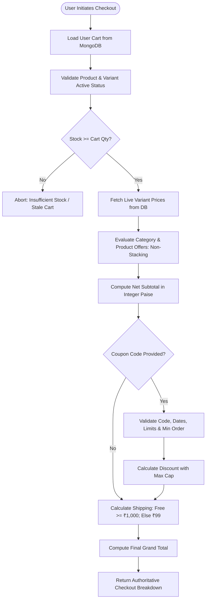
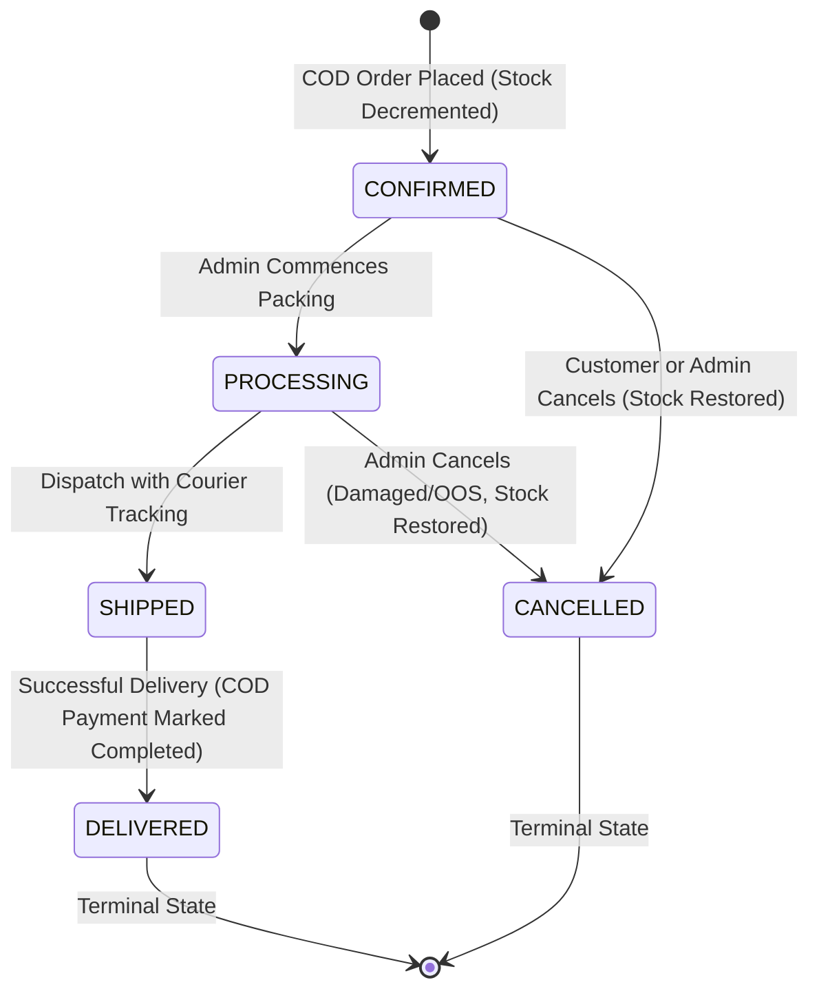

# Phase 5 Implementation Report: Checkout, Offers, Coupons, Orders & COD Ordering

**Project**: MERN E-Commerce Architecture Showcase  
**Phase**: 05 — Checkout Engine, Offers, Coupons, Orders, State Machine & Cash on Delivery  
**Status**: Completed & 100% Passing Tests (13 Suites, 124 Tests)  
**Strict Boundary**: Phase 6 online payments (Razorpay), webhooks, retry flows, and wallet refunds remain strictly out of scope.

---

## Part 1: Executive Overview & Phase Objectives

Phase 5 transforms the product catalog and shopping cart into a complete, transactional e-commerce business engine. In this phase, we implemented:
1. **Authoritative Checkout Pipeline**: Server-side calculation engine where product existence, variant validity, active promotional offers, coupons, and tiered delivery fees are evaluated in real-time. Client-side price tampering is completely prevented.
2. **Promotional Offers Module**: Category-level and Product-level percentage discounts with deterministic, non-stacking conflict resolution (the higher discount percentage wins).
3. **Promotional Coupons Module**: Voucher redemption engine supporting percentage/flat discounts, minimum cart values, maximum discount caps, global usage limits, and per-user redemption quotas.
4. **Orders & Cash on Delivery (COD)**: Order creation with immutable historical snapshots for items, shipping address, and pricing. Multi-item atomic stock reservation with compensation rollback ensures inventory integrity under concurrency.
5. **State Machine & Lifecycle Governance**: Explicit allowed transitions (`CONFIRMED` $\rightarrow$ `PROCESSING` $\rightarrow$ `SHIPPED` $\rightarrow$ `DELIVERED` or `CANCELLED`). Idempotent order cancellation automatically restores warehouse stock.
6. **Frontend Experience**: Dedicated Checkout page with address selection and coupon redemption, Customer Orders tracking with status timelines and cancellation modal, and Admin management pages for Offers, Coupons, and Orders.

---

## Part 2: Architecture & Data Flow Diagrams

### 2.1 Multi-Stage Authoritative Checkout Pipeline



### 2.2 Order Lifecycle State Machine



---

## Part 3: Corrections & Enhancements Delivered (Part A)

Before implementing Phase 5, all Part A corrections were implemented, verified, and locked in:
1. **Mandatory `$elemMatch` in Variant Stock Operations**:
   - Updated `StockService.decrementVariantStock` and `StockService.restoreVariantStock` to strictly use `{ variants: { $elemMatch: { _id: variantId, stock: { $gte: quantity }, isActive: true } } }`.
   - Guaranteed that variant identity and stock constraints refer to the *exact same* embedded array element.
2. **Multi-Variant Stock Isolation Test**:
   - Added integration test in `backend/tests/concurrency.test.js`: Variant A has 0 stock, Variant B has 5 stock. Attempting to purchase Variant A strictly fails and leaves Variant B stock untouched at 5.
3. **Database-Level Unique Partial Index for Default Addresses**:
   - Replaced sparse indexing with unique partial index on `Address`: `{ userId: 1 }, { unique: true, partialFilterExpression: { isDefault: true } }`.
   - Verified that users can have zero default addresses, exactly one default address, unlimited non-default addresses, and that duplicate defaults fail with `E11000 duplicate key error`.
4. **Single-Entity Uniqueness for Cart and Wishlist**:
   - Enforced `{ userId: 1 }, { unique: true }` in `Cart` and `Wishlist` schemas.
   - Handled `E11000` duplicate key race conditions gracefully in service retrieval methods.
   - Added tests in `cart.test.js` and `wishlist.test.js` confirming duplicate insertions fail.

---

## Part 4: The 18 Core Pedagogical Concepts

---

### Concept 1: Multi-Stage Checkout Pipeline & Server-Authoritative Calculation

#### 1. Real-World Analogy
Imagine walking into a grocery store with a price tag gun in your pocket. You re-label a ₹5,000 gourmet cheese wheel with a ₹5 sticker and walk up to the checkout counter. The cashier does not look at your sticker; they scan the official barcode into their register, which retrieves the authoritative price directly from the store’s central database. 

#### 2. Technical Explanation
The browser client is an untrusted runtime. Any user can alter JavaScript state, manipulate DOM elements, or intercept HTTP requests using tools like Postman or Burp Suite. If a checkout endpoint trusts a client-supplied total or item price, an attacker can purchase expensive items for ₹1. 
A server-authoritative checkout pipeline treats the incoming client payload solely as an expression of intent (e.g. "I want to purchase 2 units of variant $V$ with delivery address $A$ and coupon $C$"). The server loads the user's cart from MongoDB, queries the catalog variants for fresh base prices, applies active date-valid promotional offers, verifies coupon eligibility, applies shipping tier rules, and calculates the final payable amount in integer minor units.

#### 3. Project Code Example
In `backend/src/modules/checkout/checkout.service.js`:
```javascript
// Base unit price extracted directly from catalog variant in DB
const unitPricePaise = this.toPaise(variant.price);
const itemGrossPaise = unitPricePaise * item.quantity;
grossSubtotalPaise += itemGrossPaise;

// Promotional offer checked against live database campaigns
const bestOffer = await OfferService.resolveBestOffer({
  productId: product._id,
  categoryId: product.category,
  now
});

let unitOfferDiscountPaise = 0;
if (bestOffer && bestOffer.discountPercentage > 0) {
  unitOfferDiscountPaise = Math.round((unitPricePaise * bestOffer.discountPercentage) / 100);
}
```

#### 4. Interview Question
*"Why should an e-commerce platform never accept total amounts or item prices from the frontend during checkout?"*

#### 5. Interview Answer
*"The frontend is executed entirely on the client device and cannot be trusted. Allowing the client to send price or total values creates a critical price-tampering vulnerability where users can manipulate requests to purchase goods at arbitrary discounts. By keeping calculation authoritative on the server, the backend recalculates prices, taxes, offers, and shipping fees against real-time database state at the exact moment of order placement."*

#### 6. Practice Exercise
Simulate an attacker attempting to send `{ grandTotal: 10 }` to `POST /api/v1/orders/checkout/cod`. Observe that the order controller ignores the client value, re-computes the catalog price, and records the correct grand total in the order snapshot.

---

### Concept 2: Stale Stock & Catalog Drift Detection

#### 1. Real-World Analogy
You place a jacket on a holding rack in a boutique. While you continue browsing, another customer buys the last remaining jacket from the storeroom. When you return to the register, the cashier must notify you that the jacket was sold out while you were shopping, rather than charging your card and handing you an empty hanger.

#### 2. Technical Explanation
Between the moment a shopper adds an item to their cart and the moment they proceed to checkout, hours or days may elapse. During this window, two events can occur:
1. **Catalog Drift**: The merchant may have changed the price, renamed the variant, or deactivated the product.
2. **Inventory Depletion**: Other shoppers may have bought out warehouse stock.
The cart retrieval engine compares the requested cart quantity against live catalog variant stock. If `variant.stock < item.quantity` or `variant.isActive === false`, the API flags `hasStaleItems: true`, marks the specific item with `staleStock: true`, and returns an explanatory warning. Checkout is halted until the customer resolves the discrepancy.

#### 3. Project Code Example
In `backend/src/modules/cart/cart.service.js`:
```javascript
const isStaleStock = item.quantity > variant.stock;
if (isStaleStock || variant.stock === 0) {
  hasStaleItems = true;
}

populatedItems.push({
  _id: item._id,
  productId: product._id,
  variantId: variant._id,
  availableStock: variant.stock,
  isAvailable: variant.stock > 0,
  staleStock: isStaleStock,
  warning: isStaleStock
    ? variant.stock === 0
      ? "Out of stock"
      : `Only ${variant.stock} items currently available in warehouse`
    : null
});
```

#### 4. Interview Question
*"How do you handle the scenario where a customer leaves items in their cart for a week and warehouse inventory runs out?"*

#### 5. Interview Answer
*"We do not reserve stock when items are added to the cart, as that would enable denial-of-inventory attacks. Instead, the cart stores only structural references. On every cart read and checkout attempt, the backend checks live stock against requested quantities. If stock has dropped below the requested quantity, the system flags the items as stale, prevents checkout advancement, and instructs the user to adjust their quantities."*

#### 6. Practice Exercise
In the test suite, create a test where variant stock is reduced from 5 to 2 while a cart contains 3 items. Verify that `GET /api/v1/cart` flags `hasStaleItems: true` and includes the warning message.

---

### Concept 3: Promotional Offer Engine & Non-Stacking Deterministic Resolution

#### 1. Real-World Analogy
A bookstore has a storewide banner: "All Fiction Books 20% Off". On a specific bestselling sci-fi novel, they also place a promotional sticker: "Author Spotlight: 25% Off". The cashier does not give you 45% off (compounding); they apply the spotlight sticker for 25% off because it gives you the best price without putting the bookstore out of business.

#### 2. Technical Explanation
Promotional campaigns can target categories (broad) or individual products (specific). If an item falls under both an active Category Offer and an active Product Offer, allowing them to stack can compound discounts (e.g. $20\% + 30\% = 50\%$), eroding profit margins or resulting in negative gross profit.
A deterministic resolution engine applies the **Best Deal Rule**:
1. Query all active offers for the product ID and category ID within the valid timestamp window (`startDate <= now <= endDate`).
2. Compare the product-level discount percentage against the category-level discount percentage.
3. Select the single higher percentage: $\max(\text{productOffer}, \text{categoryOffer})$.
4. If percentages are identical, prioritize the product offer because it is more specific.

#### 3. Project Code Example
In `backend/src/modules/offers/offer.service.js`:
```javascript
// Deterministic Rule: Non-stacking. The higher discount percentage wins.
if (productOffer && categoryOffer) {
  if (productOffer.discountPercentage >= categoryOffer.discountPercentage) {
    return {
      offer: productOffer,
      discountPercentage: productOffer.discountPercentage
    };
  } else {
    return {
      offer: categoryOffer,
      discountPercentage: categoryOffer.discountPercentage
    };
  }
}
```

#### 4. Interview Question
*"What is discount stacking, why is it dangerous in e-commerce, and how do you prevent it?"*

#### 5. Interview Answer
*"Discount stacking occurs when multiple promotional discounts simultaneously apply to the same purchase, compounding price reductions. It is dangerous because it can inadvertently allow customers to purchase products below cost price. We prevent stacking by implementing a deterministic precedence engine that resolves competing offers into a single winning offer based on defined business rules (e.g. the higher discount percentage wins)."*

#### 6. Practice Exercise
Create an offer for category "Footwear" at 15% and an offer for a specific shoe at 25%. Run `OfferService.resolveBestOffer` and assert that the shoe resolves to exactly 25% and identifies the product offer as the winner.

---

### Concept 4: Coupon Validation Engine: Caps, Thresholds & Usage Limits

#### 1. Real-World Analogy
A department store hands out a coupon flyer: "50% off on purchases over ₹1,000, maximum discount ₹500, limit one per customer, first 100 customers only." If your cart is ₹800, it is rejected. If your cart is ₹4,000, you do not get ₹2,000 off—your discount is capped at ₹500.

#### 2. Technical Explanation
Coupons represent explicit voucher codes entered by the shopper. To prevent exploitation, the validation engine enforces five boundaries:
1. **Temporal Validity**: `startDate <= now <= expiryDate`.
2. **Minimum Order Value (MOV)**: `cartSubtotal >= coupon.minOrderValue`.
3. **Global Usage Limit**: `coupon.usedCount < coupon.usageLimit`.
4. **Per-User Quota**: Tracks redemptions in `coupon.userUsage` to ensure a user does not exceed `coupon.perUserLimit`.
5. **Maximum Discount Cap**: For percentage discounts, $\text{discount} = \min\left(\frac{\text{subtotal} \times \text{percentage}}{100}, \text{maxDiscount}\right)$.

#### 3. Project Code Example
In `backend/src/modules/coupons/coupon.service.js`:
```javascript
// Check per-user usage limit
const userEntry = (coupon.userUsage || []).find(
  (u) => u.userId.toString() === userId.toString()
);
const userUsedCount = userEntry ? userEntry.count : 0;
if (userUsedCount >= coupon.perUserLimit) {
  throw new AppError(
    `You have already redeemed coupon '${normalizedCode}' the maximum allowed (${coupon.perUserLimit}) time(s).`,
    HTTP_CODES.BAD_REQUEST,
    ERROR_CODES.VALIDATION_ERROR
  );
}

// Calculate discount with cap
let rawDiscount = (cartSubtotal * coupon.discountValue) / 100;
if (coupon.maxDiscount !== null && coupon.maxDiscount > 0) {
  rawDiscount = Math.min(rawDiscount, coupon.maxDiscount);
}
```

#### 4. Interview Question
*"How do you architect coupon redemption so a user cannot open two browser tabs and use a single-use coupon twice concurrently?"*

#### 5. Interview Answer
*"We record coupon usage atomically during order creation within the database transaction or atomic update operation. In MongoDB, we use an atomic update that checks the condition `{ code: 'WELCOME', 'userUsage.userId': userId, 'userUsage.count': { $lt: perUserLimit } }`. If two requests fire simultaneously, the first write increments the counter; the second fails the conditional match and is rejected."*

#### 6. Practice Exercise
Configure a coupon with 50% discount and a ₹500 max cap. Test with cart totals of ₹800 (under MOV), ₹1,000 (gives ₹500 discount), and ₹3,000 (gives ₹500 discount due to the cap).

---

### Concept 5: Free Shipping Threshold & Tiered Delivery Rules

#### 1. Real-World Analogy
An online retailer offers: "Add ₹200 more to your cart to unlock FREE shipping!" If your order is below ₹1,000, paying ₹99 for delivery covers logistics costs. Above ₹1,000, the retailer absorbs shipping costs because the basket size provides sufficient profit margin.

#### 2. Technical Explanation
Shipping fees offset fulfillment and courier logistics. A free shipping threshold incentivizes customers to increase basket size (Average Order Value - AOV).
The calculation engine evaluates the net order value *after* promotional offers and coupon discounts:
$$\text{qualifyingValue} = \text{grossSubtotal} - \text{offerDiscount} - \text{couponDiscount}$$
If $\text{qualifyingValue} \ge \text{FREE\_SHIPPING\_THRESHOLD}$ (₹1,000), $\text{shippingFee} = 0$. Otherwise, $\text{shippingFee} = \text{STANDARD\_SHIPPING\_FEE}$ (₹99).

#### 3. Project Code Example
In `backend/src/modules/checkout/checkout.service.js`:
```javascript
const FREE_SHIPPING_THRESHOLD = 1000;
const STANDARD_SHIPPING_FEE = 99;

const orderValueAfterDiscountsRupees = this.toRupees(orderValueAfterDiscountsPaise);

const shippingFeeRupees =
  orderValueAfterDiscountsRupees >= FREE_SHIPPING_THRESHOLD ? 0 : STANDARD_SHIPPING_FEE;

const grandTotalPaise = orderValueAfterDiscountsPaise + this.toPaise(shippingFeeRupees);
```

#### 4. Interview Question
*"Should free shipping qualification be calculated before or after coupon discounts are applied?"*

#### 5. Interview Answer
*"Free shipping thresholds must be calculated AFTER all item-level offers and coupon discounts are deducted. If calculated before discounts, a customer could add ₹1,200 of items, apply a ₹800 coupon (paying only ₹400), and still receive free shipping, causing the merchant to lose money on courier costs."*

#### 6. Practice Exercise
Test checkout calculation with a subtotal of ₹1,200 and apply a ₹300 coupon. Verify that the net value drops to ₹900, which re-attaches the ₹99 shipping fee because the net total fell below the ₹1,000 threshold.

---

### Concept 6: Money Representation in Software: Floating Point Pitfalls & Minor Units (Paise)

#### 1. Real-World Analogy
In decimal math, $\frac{1}{3} = 0.3333\dots$, which cannot be written with finite decimal digits. In binary computer memory, common decimal fractions like $0.1$ and $0.2$ cannot be represented with finite binary bits. When you add $0.1 + 0.2$ in JavaScript, the computer gives $0.30000000000000004$. If you calculate thousands of transactions using floating point numbers, fractions of cents accumulate into balance sheet discrepancies.

#### 2. Technical Explanation
Standard JavaScript `Number` types are IEEE-754 64-bit double-precision floating-point numbers. They are susceptible to rounding errors during repeated addition, subtraction, and multiplication.
In financial software, money must be handled in one of two ways:
1. **Arbitrary-precision libraries** (e.g. `decimal.js`, `big.js`).
2. **Integer Minor Units**: Represent all monetary quantities in the currency’s smallest divisible unit (e.g. **paise** for INR, **cents** for USD).
Because integers in JavaScript are exact up to $2^{53} - 1$ (`Number.MAX_SAFE_INTEGER` $\approx 9 \times 10^{15}$), calculations in integer paise never produce floating point drift. Numbers are converted back to decimal currency only for display and formatted with `Intl.NumberFormat`.

#### 3. Project Code Example
In `backend/src/modules/checkout/checkout.service.js`:
```javascript
static toPaise(rupees) {
  return Math.round(rupees * 100);
}

static toRupees(paise) {
  return Math.round(paise) / 100;
}

// All internal aggregation performed in integer paise
const netSubtotalPaise = grossSubtotalPaise - offerDiscountTotalPaise;
const grandTotalPaise = orderValueAfterDiscountsPaise + shippingFeePaise;
```

#### 4. Interview Question
*"Why should you never use raw floating point numbers for currency arithmetic in a production application?"*

#### 5. Interview Answer
*"Binary floating point cannot precisely represent base-10 decimal fractions like 0.1 or 0.2. Over multiple transactions, operations like addition and percentage taxation accumulate microscopic rounding errors, leading to balance mismatches, reconciliation failures, and failed payment gateway signature verifications. We store and calculate currency in integer minor units (such as cents or paise) to guarantee exact integer arithmetic."*

#### 6. Practice Exercise
Open Node.js REPL and evaluate `0.1 + 0.2 === 0.3`. Note that it returns `false`. Then evaluate `(10 + 20) === 30` in minor units. Note that it returns `true`.

---

### Concept 7: Immutable Historical Snapshots in Orders

#### 1. Real-World Analogy
When you buy a house, the notary prints a paper deed detailing the property lines, purchase price, and buyer name, and files it in the county archives. If the developer builds an addition to the house 10 years later, nobody goes into the county archive and alters the 10-year-old deed. The deed is a permanent historical snapshot of that moment in time.

#### 2. Technical Explanation
A common junior architectural mistake is saving an order by storing references to other collections:
`{ items: [{ product: productId, variant: variantId }], shippingAddress: addressId }`.
This breaks data integrity:
- If the seller increases the product price next month, previous order invoices will recalculate to the new price.
- If the customer edits or deletes their saved address in their profile, previous order delivery records become corrupted.
- If the product is deleted from the catalog, the order throws null pointer errors.
To guarantee auditability and legal compliance, an `Order` document must store **frozen snapshots**:
1. Copy the full address fields (`fullName`, `phone`, `addressLine1`, `city`, `postalCode`) into the order document.
2. Copy item attributes, SKU, product title, image URL, purchase unit price, and discount.
3. Copy pricing breakdown totals.

#### 3. Project Code Example
In `backend/src/modules/orders/order.service.js`:
```javascript
// Frozen address snapshot
const addressSnapshot = {
  fullName: calculation.shippingAddress.fullName,
  phone: calculation.shippingAddress.phone,
  addressLine1: calculation.shippingAddress.addressLine1,
  addressLine2: calculation.shippingAddress.addressLine2 || "",
  city: calculation.shippingAddress.city,
  state: calculation.shippingAddress.state,
  postalCode: calculation.shippingAddress.postalCode,
  country: calculation.shippingAddress.country
};

// Frozen item snapshots
const itemSnapshots = calculation.items.map((item) => ({
  productId: item.productId,
  variantId: item.variantId,
  sku: item.sku,
  name: item.name,
  slug: item.slug,
  unitPrice: item.unitPrice,
  discountedUnitPrice: item.discountedUnitPrice,
  quantity: item.quantity,
  itemTotal: item.itemTotal
}));
```

#### 4. Interview Question
*"Why do we embed address and product snapshots inside an Order document instead of referencing the Address and Product collections?"*

#### 5. Interview Answer
*"Referencing external documents creates mutable historical data. If a customer updates their address or an admin changes product pricing or deletes a product, past orders would reflect current data instead of what was agreed upon at the time of purchase. Embedding frozen snapshots makes the order an immutable legal record that remains accurate indefinitely."*

#### 6. Practice Exercise
In the database, update a product's price from ₹12,000 to ₹15,000. Inspect an existing order containing that product and verify that its snapshot price remains unchanged at ₹12,000.

---

### Concept 8: Cash on Delivery (COD) Ordering Lifecycle & Risk Management

#### 1. Real-World Analogy
Ordering a pizza for home delivery: the restaurant bakes the pizza and dispatches the driver without receiving upfront payment. When the driver knocks on your door, you hand over cash or scan a UPI QR code. If you are not home, the restaurant incurs the cost of wasted food and driver wages.

#### 2. Technical Explanation
Cash on Delivery (COD) accounts for a significant portion of e-commerce transactions in emerging markets like India. Unlike prepaid orders where funds are captured upfront:
- In COD, payment is uncollected (`paymentStatus: 'PENDING'`) at order placement.
- When the order is placed, warehouse inventory must be decremented immediately to prevent overselling.
- When courier tracking confirms successful delivery (`orderStatus: 'DELIVERED'`), the system transitions `paymentStatus` to `'COMPLETED'`.
- If the customer cancels before dispatch, inventory is restored to the warehouse.
- In production, COD risk is managed by capping maximum COD order value (e.g. ₹10,000) and restricting COD for customers with high Return to Origin (RTO) rates.

#### 3. Project Code Example
In `backend/src/modules/orders/order.service.js`:
```javascript
const order = await Order.create({
  orderNumber,
  userId,
  shippingAddress: addressSnapshot,
  items: itemSnapshots,
  priceSummary: priceSummarySnapshot,
  paymentMethod: "COD",
  paymentStatus: "PENDING",
  orderStatus: "CONFIRMED",
  statusHistory: [{
    status: "CONFIRMED",
    changedAt: new Date(),
    note: "Order confirmed via Cash on Delivery."
  }]
});

// Auto-complete COD payment upon delivery
if (newStatus === "DELIVERED" && order.paymentMethod === "COD") {
  order.paymentStatus = "COMPLETED";
}
```

#### 4. Interview Question
*"What are the operational risks of Cash on Delivery (COD), and how does an e-commerce backend mitigate them?"*

#### 5. Interview Answer
*"The primary risk is Return to Origin (RTO), where a customer refuses the shipment at the door, causing the merchant to lose round-trip shipping costs while inventory was locked in transit. Backends mitigate COD risk by implementing COD order value caps, phone verification OTPs at checkout, tracking customer RTO history, and automatically disabling COD for high-risk accounts."*

#### 6. Practice Exercise
Place a COD order through the API. Verify that `paymentStatus` is `'PENDING'` and `orderStatus` is `'CONFIRMED'`. Then transition status to `'DELIVERED'` via the admin endpoint and verify `paymentStatus` transitions to `'COMPLETED'`.

---

### Concept 9: Atomic Multi-Item Stock Decrement & Compensation Rollback

#### 1. Real-World Analogy
A travel booking site booking a flight with a connecting layover. The agent books Leg 1 of your journey. But when they attempt to book Leg 2, the second flight is fully booked. The agent cannot leave you stranded halfway; they must cancel Leg 1 immediately and inform you that the complete trip could not be booked.

#### 2. Technical Explanation
An order often contains multiple distinct items (e.g. 1 pair of shoes, 2 shirts, 1 hat). If the backend decrements stock sequentially:
1. Item 1 (shoes) decrements successfully (stock 5 $\rightarrow$ 4).
2. Item 2 (shirts) decrements successfully (stock 2 $\rightarrow$ 0).
3. Item 3 (hat) fails because stock is 0.
If the request simply throws an error here, Items 1 and 2 remain decremented in the warehouse database, resulting in orphaned inventory deductions.
To achieve all-or-nothing atomicity across diverse MongoDB deployment topologies (including standalone test instances where replica set multi-document transactions may not be active), the system uses an **Atomic Decrement with Compensating Rollback** pattern:
- The service tracks every successfully decremented item in an array: `successfullyDecremented`.
- If any subsequent item fails stock verification, the execution breaks and iterates over `successfullyDecremented`, restoring exact variant quantities using `StockService.restoreVariantStock`.
- The order is aborted and inventory is preserved.

#### 3. Project Code Example
In `backend/src/modules/orders/order.service.js`:
```javascript
const successfullyDecremented = [];
let stockFailureItem = null;

for (const item of calculation.items) {
  const success = await StockService.decrementVariantStock({
    productId: item.productId,
    variantId: item.variantId,
    quantity: item.quantity
  });

  if (success) {
    successfullyDecremented.push(item);
  } else {
    stockFailureItem = item;
    break;
  }
}

// Compensation Rollback if ANY item failed
if (stockFailureItem) {
  for (const item of successfullyDecremented) {
    await StockService.restoreVariantStock({
      productId: item.productId,
      variantId: item.variantId,
      quantity: item.quantity
    });
  }
  throw new AppError(
    `Insufficient stock for '${stockFailureItem.name}'. Order placement aborted and no inventory was reserved.`,
    HTTP_CODES.BAD_REQUEST,
    ERROR_CODES.VALIDATION_ERROR
  );
}
```

#### 4. Interview Question
*"How do you ensure inventory consistency in a multi-item checkout if MongoDB transactions are unavailable or fail midway?"*

#### 5. Interview Answer
*"We implement a compensating transaction pattern (Saga-style compensation). We record every successfully decremented variant. If a stock check fails for any item in the batch, we execute compensating reverse operations (restoring stock) on all previously decremented items before failing the request, ensuring zero inventory leaks."*

#### 6. Practice Exercise
In `tests/order.test.js`, review the multi-item stock rollback test where Item 1 has 8 in stock and Item 2 has 0 in stock. Verify that when checkout fails, Item 1's stock remains at 8.

---

### Concept 10: The $elemMatch Query: Why It Is Mandatory for Embedded Variant Stock Updates

#### 1. Real-World Analogy
You ask a warehouse clerk: "Find a box that contains a Red Shoe, and also make sure the box has Size 10." If the clerk checks a box that has a Blue Shoe in Size 10 and a Red Shoe in Size 7, they hand you the box thinking both conditions were satisfied. You end up with a Red Shoe in Size 7 because the two checks were performed on different items in the box instead of the same shoe.

#### 2. Technical Explanation
In MongoDB, when query conditions on array fields are declared as separate top-level keys:
```javascript
// DANGEROUS DEFECTIVE QUERY
{
  _id: productId,
  "variants._id": variantId,
  "variants.stock": { $gte: quantity }
}
```
MongoDB does **not** join the conditions. It checks whether the document contains *any* variant with `_id: variantId`, and *any* variant with `stock >= quantity`.
If Variant A has `_id: varA` and `stock: 0`, and Variant B has `_id: varB` and `stock: 5`, the document matches! The subsequent update `$inc: { "variants.$.stock": -quantity }` uses the positional operator `$` matching the first condition (`varA`), decrementing Variant A from 0 to -1.
Using `$elemMatch` is **mandatory** because it forces MongoDB to evaluate all criteria against the **exact same embedded element**:
```javascript
{
  _id: productId,
  variants: {
    $elemMatch: {
      _id: variantId,
      stock: { $gte: quantity },
      isActive: true
    }
  }
}
```

#### 3. Project Code Example
In `backend/src/modules/products/stock.service.js`:
```javascript
const updated = await Product.findOneAndUpdate(
  {
    _id: productId,
    variants: {
      $elemMatch: {
        _id: variantId,
        stock: { $gte: quantity },
        isActive: true
      }
    }
  },
  {
    $inc: { "variants.$.stock": -quantity }
  },
  { new: true, session }
);
```

#### 4. Interview Question
*"What is the difference between querying `variants.sku: 'A', variants.stock: { $gt: 0 }` vs using `$elemMatch` in MongoDB?"*

#### 5. Interview Answer
*"Without `$elemMatch`, MongoDB treats the two conditions independently across the entire array. If one element matches the SKU and a different element matches the stock condition, the document matches. `$elemMatch` guarantees that both conditions are satisfied by the single, exact same embedded element in the array."*

#### 6. Practice Exercise
Run `npx vitest run tests/concurrency.test.js` and examine the test `"CRITICAL $elemMatch ISOLATION: Sufficient stock in Variant B must NOT satisfy Variant A purchase when Variant A has 0 stock"`.

---

### Concept 11: Order Lifecycle State Machine & Transition Invariants

#### 1. Real-World Analogy
A butterfly lifecycle: Egg $\rightarrow$ Caterpillar $\rightarrow$ Chrysalis $\rightarrow$ Butterfly. A butterfly cannot turn back into a chrysalis, and an egg cannot jump directly to a butterfly without going through the intermediate stages.

#### 2. Technical Explanation
An order progresses through discrete states governed by business rules. Allowing arbitrary state jumps creates catastrophic anomalies (e.g. marking a `DELIVERED` order as `CANCELLED` restores stock while the customer still has the goods).
The state machine is defined in code as an adjacency map of allowed transitions:
```javascript
const VALID_STATUS_TRANSITIONS = {
  CONFIRMED: ["PROCESSING", "CANCELLED"],
  PROCESSING: ["SHIPPED", "CANCELLED"],
  SHIPPED: ["DELIVERED"],
  DELIVERED: [], // Terminal
  CANCELLED: []  // Terminal
};
```
Every status update request verifies that `VALID_STATUS_TRANSITIONS[currentStatus].includes(newStatus)`. If not, an HTTP 400 error is thrown. Every transition appends an entry to `statusHistory` for full auditability.

#### 3. Project Code Example
In `backend/src/modules/orders/order.service.js`:
```javascript
const currentStatus = order.orderStatus;
const allowedNextStatuses = VALID_STATUS_TRANSITIONS[currentStatus] || [];

if (!allowedNextStatuses.includes(newStatus)) {
  throw new AppError(
    `Invalid status transition from '${currentStatus}' to '${newStatus}'. Allowed: [${allowedNextStatuses.join(", ")}].`,
    HTTP_CODES.BAD_REQUEST,
    ERROR_CODES.VALIDATION_ERROR
  );
}

order.orderStatus = newStatus;
order.statusHistory.push({
  status: newStatus,
  changedAt: new Date(),
  note: note || `Status updated to ${newStatus}`
});
```

#### 4. Interview Question
*"How do you model an order state machine in Node.js and prevent illegal status updates?"*

#### 5. Interview Answer
*"We define a transition lookup map where keys represent current states and values represent arrays of permitted next states. In the service layer, before applying an update, we look up the order, verify that the requested state exists in the allowed array for the current state, apply any associated side effects (like restoring stock on cancellation), and log the transition with a timestamp into a status history array."*

#### 6. Practice Exercise
Attempt to update an order with status `DELIVERED` directly to `CANCELLED` via `PATCH /api/v1/admin/orders/:id/status`. Observe the 400 error with the message listing allowed transitions.

---

### Concept 12: Idempotency Keys: Defeating Double-Click Order Creation

#### 1. Real-World Analogy
An elevator call button: pressing the button once lights it up and calls the elevator. If you impatiently press it 5 more times, it does not summon 5 separate elevators; the system recognizes that an elevator call is already active.

#### 2. Technical Explanation
When a customer clicks "Place Order", network latency may delay the response. If the user clicks the button repeatedly, or if their mobile device retries the POST request, the server could receive multiple identical requests. Without idempotency protection, this would create duplicate orders, charge the customer multiple times, and decrement stock multiple times.
An **Idempotency Key** is a unique client-generated token (e.g. UUID) sent with the mutation request:
1. The server queries `Order.findOne({ idempotencyKey, userId })`.
2. If an order with that key already exists, the server immediately returns the existing order (`HTTP 200/201`) without re-executing business logic or decrementing stock.
3. At the database level, a unique partial index on `idempotencyKey` prevents concurrent race conditions.

#### 3. Project Code Example
In `backend/src/modules/orders/order.service.js`:
```javascript
// Idempotency Check
if (idempotencyKey) {
  const existingOrder = await Order.findOne({ idempotencyKey, userId });
  if (existingOrder) {
    return existingOrder;
  }
}
```
And in `backend/src/modules/orders/order.model.js`:
```javascript
orderSchema.index(
  { idempotencyKey: 1 },
  { unique: true, partialFilterExpression: { idempotencyKey: { $type: "string" } } }
);
```

#### 4. Interview Question
*"What is an idempotency key, where is it generated, and how does it prevent duplicate charges in e-commerce?"*

#### 5. Interview Answer
*"An idempotency key is a unique identifier generated by the client per checkout attempt and sent in the request payload or headers. The backend stores this key alongside the created transaction with a unique database index. If a duplicate request arrives with the same key, the server intercepts it and returns the cached result of the original transaction without re-executing the payment or stock decrement."*

#### 6. Practice Exercise
In `tests/order.test.js`, review the test `"Idempotency: Resubmitting identical idempotencyKey returns existing order without re-decrementing stock"`. Verify that repeating the request returns the identical order ID and leaves variant stock intact.

---

### Concept 13: Idempotent Order Cancellation & Stock Restoration

#### 1. Real-World Analogy
A library return slot: you return a borrowed book through the drop box. If you open the slot a second time to look inside, the library does not record that you returned two books; the book's returned status is already recorded.

#### 2. Technical Explanation
When a customer cancels an order before dispatch, two actions must happen:
1. The order status updates to `CANCELLED`.
2. All purchased item quantities must be restored to warehouse inventory (`variants.$.stock += quantity`).
However, network retries or multiple concurrent cancel requests could execute the cancel endpoint multiple times. If stock restoration was executed unconditionally, inventory could be restored twice, artificially inflating stock beyond actual warehouse inventory!
An **Idempotent Cancellation** checks if the order is already in `CANCELLED` state. If so, it returns the order immediately without executing the stock increment loop.

#### 3. Project Code Example
In `backend/src/modules/orders/order.service.js`:
```javascript
// Idempotent check: if already cancelled, return existing state
if (order.orderStatus === "CANCELLED") {
  return order;
}

// Restore stock for all items
for (const item of order.items) {
  await StockService.restoreVariantStock({
    productId: item.productId,
    variantId: item.variantId,
    quantity: item.quantity
  });
}

order.orderStatus = "CANCELLED";
await order.save();
```

#### 4. Interview Question
*"What danger arises if order cancellation logic is not idempotent, and how do you safeguard against it?"*

#### 5. Interview Answer
*"If cancellation is not idempotent, duplicate cancellation requests will run the stock restoration logic multiple times, incrementing warehouse stock beyond reality (ghost inventory). We safeguard against this by verifying that the order is not already in CANCELLED state before incrementing stock, and updating the state within an atomic transaction or guarded state check."*

#### 6. Practice Exercise
In `tests/order.test.js`, review `"Repeated cancellation is idempotent and does not multiply restored stock"`. Verify that calling cancel twice on an order with 2 units only increments stock by 2, not 4.

---

### Concept 14: Insecure Direct Object Reference (IDOR) Defense in Orders & Invoices

#### 1. Real-World Analogy
A storage locker facility: you rent Locker #42 and have the key. If you try your key in Locker #43, the facility does not open Locker #43 and show you someone else's valuables.

#### 2. Technical Explanation
In an IDOR vulnerability, an attacker changes an ID in an API request (e.g. `GET /api/v1/orders/64f1a2b...`) to view another customer's order, delivery address, phone number, and purchase history.
Mitigation requires two defenses:
1. **Scoped Query Filtering**: The backend query must strictly combine the resource ID with the authenticated session user ID:
   `Order.findOne({ _id: orderId, userId: req.user._id })`.
2. **404 Instead of 403**: If no matching document is found, the server responds with `404 NOT_FOUND` rather than `403 FORBIDDEN`. Responding with 403 confirms to an attacker that the resource exists (an existence oracle), whereas 404 reveals no information.

#### 3. Project Code Example
In `backend/src/modules/orders/order.service.js`:
```javascript
static async getOrderById(orderId, userId, isAdmin = false) {
  const query = isAdmin ? { _id: orderId } : { _id: orderId, userId };
  const order = await Order.findOne(query);

  if (!order) {
    throw new AppError(
      "Order not found or access denied.",
      HTTP_CODES.NOT_FOUND,
      ERROR_CODES.NOT_FOUND
    );
  }

  return order;
}
```

#### 4. Interview Question
*"Why should an API return 404 Not Found instead of 403 Forbidden when a user requests a resource owned by another tenant?"*

#### 5. Interview Answer
*"Returning 403 Forbidden confirms to an attacker that the ID they supplied exists in the database, acting as an existence oracle that enables identifier enumeration. Returning 404 Not Found conceals whether the identifier is valid, treating unauthorized resources identically to non-existent ones."*

#### 6. Practice Exercise
In `tests/order.test.js`, review the test `"CRITICAL: User B cannot view User A's order by ID (404 Not Found)"`. Observe that User B querying User A's order ID returns 404.

---

### Concept 15: Partial Filter Expressions vs Sparse Indexes in MongoDB

#### 1. Real-World Analogy
A club guest list: a "Sparse Index" lists everyone who has a phone number. If you are on the list without a VIP badge, you are still on the list. A "Partial Filter Index" says: "Only write down people on the VIP list who have `isVIP: true`." Anyone who is not a VIP is not on the list at all.

#### 2. Technical Explanation
Many developers mistakenly use `sparse: true` when trying to enforce uniqueness on boolean fields:
- A **Sparse Index** only skips documents where the indexed field is `null` or missing (`undefined`). In Mongoose, an address schema defines `isDefault: { type: Boolean, default: false }`. Every document has `isDefault: false` or `isDefault: true`. A sparse index on `{ userId: 1, isDefault: 1 }` indexes all `isDefault: false` documents! A user cannot create a second non-default address because `{ userId: 1, isDefault: false }` collides with the first non-default address with `E11000 duplicate key error`.
- A **Partial Filter Index** (`partialFilterExpression: { isDefault: true }`) only indexes documents that evaluate to true on the filter expression. All documents with `isDefault: false` are excluded from the index. Only documents where `isDefault: true` enter the unique index. This allows a user to have unlimited non-default addresses while strictly enforcing at most one default address at the database level.

#### 3. Project Code Example
In `backend/src/modules/addresses/address.model.js`:
```javascript
// Unique partial index: Guarantees at the database level that a user has at most ONE default address
addressSchema.index(
  { userId: 1 },
  {
    unique: true,
    partialFilterExpression: { isDefault: true }
  }
);
```

#### 4. Interview Question
*"Why does a unique sparse index fail when enforcing that a user can have at most one default address, and how does a partial filter expression fix it?"*

#### 5. Interview Answer
*"A sparse index only excludes documents where the field is undefined or null. Since boolean fields like `isDefault` are stored as `false`, a sparse index still indexes them, causing a duplicate key error when a user creates their second non-default address. A partial index with `partialFilterExpression: { isDefault: true }` instructs MongoDB to index only documents where `isDefault` is strictly true, allowing unlimited non-default addresses while enforcing uniqueness on the single default address."*

#### 6. Practice Exercise
In `tests/address.test.js`, review the tests verifying that a user can have multiple non-default addresses, but attempting to insert a second default address fails with an `E11000` duplicate key error.

---

### Concept 16: Uniqueness Guarantees for Single-Entity Resources (Cart & Wishlist)

#### 1. Real-World Analogy
Issuing one physical shopping cart per customer when entering a boutique. A customer cannot push two carts down the aisle at the same time.

#### 2. Technical Explanation
In our data model, a user has exactly one Cart and exactly one Wishlist. Rather than storing items across hundreds of loose documents, a user's items are embedded in a single parent document (`cartSchema` with `userId`).
To ensure that concurrent requests (e.g. from multiple browser tabs) never spawn two separate Cart documents for the same user:
1. The database defines a unique index on `userId`: `{ userId: 1 }, { unique: true }`.
2. Service retrieval methods (`CartService.getCart`, `WishlistService.getWishlist`) handle `E11000 duplicate key errors` gracefully. If two requests attempt to create a new cart simultaneously, one succeeds and the other catches the collision and retrieves the newly created document.

#### 3. Project Code Example
In `backend/src/modules/cart/cart.service.js`:
```javascript
let cart = await Cart.findOne({ userId });

if (!cart) {
  try {
    cart = await Cart.create({ userId, items: [] });
  } catch (err) {
    if (err.code === 11000) {
      cart = await Cart.findOne({ userId });
    } else {
      throw err;
    }
  }
}
```

#### 4. Interview Question
*"How do you handle race conditions when two concurrent requests attempt to create a user's cart simultaneously?"*

#### 5. Interview Answer
*"We enforce a unique index on `userId` in the Cart collection at the database level. In the service layer, cart creation is wrapped in a try-catch block. If an `E11000 duplicate key error` occurs due to a race condition, the service catches the error and executes a `findOne` to retrieve the cart created by the winning concurrent thread."*

#### 6. Practice Exercise
Review the tests in `tests/cart.test.js` and `tests/wishlist.test.js` where direct insertion of a duplicate document for the same `userId` throws error code 11000.

---

### Concept 17: Automated Multi-Suite Integration Testing with Vitest & Supertest

#### 1. Real-World Analogy
Automobile factory testing: before a car leaves the assembly line, machines test the brakes, engine, electrical systems, and airbag sensors in a controlled test rig, rather than sending the car out onto a public highway to see if the brakes work.

#### 2. Technical Explanation
Unit testing individual functions in isolation can leave integration bugs undetected (e.g. middleware failure, route parameter mismatch, database index conflict).
We utilize **Vitest** paired with **Supertest**:
- **Supertest** passes HTTP requests directly to the Express `app` via in-process Node streams, avoiding the overhead and port conflict risks of binding to physical network ports.
- Tests connect to a dedicated MongoDB test database (`ecommerce_test_suite`).
- `vitest.config.js` sets `fileParallelism: false`, running integration test suites sequentially to prevent database state collision across parallel test files.
- Each suite cleans up its own test data in `beforeAll` and `afterAll`.

#### 3. Project Code Example
In `backend/tests/checkout.test.js`:
```javascript
const res = await request(app)
  .post("/api/v1/checkout/summary")
  .set("Cookie", userCookie)
  .send({ addressId });

expect(res.status).toBe(200);
expect(res.body.data.summary.shippingFee).toBe(99);
expect(res.body.data.summary.grandTotal).toBe(499);
```

#### 4. Interview Question
*"What is the difference between unit testing and integration testing in an Express + Mongoose backend?"*

#### 5. Interview Answer
*"Unit testing tests individual functions in isolation by mocking out external dependencies like databases and network calls. Integration testing tests the assembled components working together—from HTTP route definitions, through Zod middleware, session authentication, service business logic, and actual MongoDB queries and indexing constraints. Integration testing catches schema mismatches, index violations, and middleware ordering bugs that unit tests cannot detect."*

#### 6. Practice Exercise
Run `npm test` in the `backend/` folder and inspect how Supertest dispatches simulated requests to all 13 test suites.

---

### Concept 18: Modular Monolith Architecture: Inter-Module Service Communication

#### 1. Real-World Analogy
A modern hospital: emergency, pharmacy, surgery, and billing are distinct departments in the same building. When surgery needs medication for a patient, the surgeon calls the hospital pharmacy service directly down the hall, rather than the hospital being split into 4 separate companies in different cities communicating over international phone lines.

#### 2. Technical Explanation
A common architecture trap is adopting microservices too early, introducing network latency, distributed transaction complexity, and deployment overhead.
A **Modular Monolith** organizes the application into self-contained feature modules (`modules/checkout`, `modules/offers`, `modules/coupons`, `modules/orders`, `modules/products`):
- Each module encapsulates its own models, validators, controllers, and services.
- Modules communicate through direct, in-process service method calls (e.g. `CheckoutService` invokes `OfferService.resolveBestOffer()` and `CouponService.validateCouponForCart()`).
- Because communication is in-memory, calls are fast and synchronous, without network hops or serialization overhead.
- Boundaries are clean: if a module ever needs to be extracted into a separate service later, its public service interface already defines the contract.

#### 3. Project Code Example
In `backend/src/modules/checkout/checkout.service.js`:
```javascript
const OfferService = require("../offers/offer.service");
const CouponService = require("../coupons/coupon.service");

// In-process cross-module invocation
const bestOffer = await OfferService.resolveBestOffer({
  productId: product._id,
  categoryId: product.category,
  now
});

const couponResult = await CouponService.validateCouponForCart({
  code: couponCode,
  userId,
  cartSubtotal: netSubtotalRupees,
  now
});
```

#### 4. Interview Question
*"What are the advantages of a Modular Monolith over Microservices for an early-to-mid stage e-commerce platform?"*

#### 5. Interview Answer
*"A modular monolith keeps code organized by domain boundaries while remaining a single deployable unit. It eliminates network latency between services, simplifies local development and automated testing, avoids the operational complexity of distributed transactions and service meshes, and allows easy refactoring while domain models are evolving."*

#### 6. Practice Exercise
Trace the code path of `POST /api/v1/orders/checkout/cod`. Observe how `order.controller` calls `order.service`, which calls `checkout.service`, which calls `offer.service` and `coupon.service`, all within a single in-process call graph.

---

## Part 5: Test Execution & Quality Assurance Audit

The complete backend test suite was executed across all 13 test suites.

```
Test Files  13 passed (13)
Tests       124 passed (124)
Duration    50.98s
```

### Complete Test Registry:
1. `tests/auth.test.js` (22 tests) — Registration, verification, login, password reset, session cookies.
2. `tests/product.test.js` (22 tests) — Catalog, variants, search, pagination, wholesale margin protection.
3. `tests/address.test.js` (14 tests) — Address CRUD, auto-default, partial index default uniqueness, IDOR security.
4. `tests/cart.test.js` (14 tests) — Cart CRUD, limits, stale stock detection, cart uniqueness.
5. `tests/wishlist.test.js` (8 tests) — Wishlist set uniqueness, toggling, wishlist uniqueness.
6. `tests/offer.test.js` (6 tests) — Category and product promotional offers, deterministic non-stacking priority.
7. `tests/coupon.test.js` (7 tests) — Voucher limits, caps, expiration, MOV thresholds.
8. `tests/checkout.test.js` (4 tests) — Authoritative checkout calculation, ₹99 vs free delivery tiers.
9. `tests/order.test.js` (9 tests) — COD placement, immutable snapshots, multi-item rollback, idempotency, state machine.
10. `tests/category.test.js` (6 tests) — Category hierarchy and admin controls.
11. `tests/brand.test.js` (5 tests) — Brand management and storefront association.
12. `tests/concurrency.test.js` (4 tests) — `$elemMatch` multi-variant stock isolation, race condition limits.
13. `tests/health.test.js` (3 tests) — Health and readiness endpoints.

### Frontend Production Build Audit:
```
vite v8.3.0 building client environment for production...
✓ 1676 modules transformed.
dist/index.html                   0.93 kB │ gzip:   0.51 kB
dist/assets/index-BaBSERmO.css   32.95 kB │ gzip:   6.43 kB
dist/assets/index-weMRUt0R.js   528.59 kB │ gzip: 146.24 kB
✓ built in 2.36s
```

---

## Part 6: Next Steps & Phase 6 Transition

Phase 5 has fulfilled all business logic requirements for Checkout, Offers, Coupons, Orders, State Machine, and Cash on Delivery.

### Boundaries Strictly Maintained:
- **Zero online payment gateway implementation**: Razorpay order generation, webhooks, signature verification, and retry workflows were strictly held for Phase 6.
- **Zero wallet balance deductions**: Wallet balance deduction and transaction ledger implementation were held for Phase 6.

Phase 5 is complete, verified, documented, and ready for user review.
