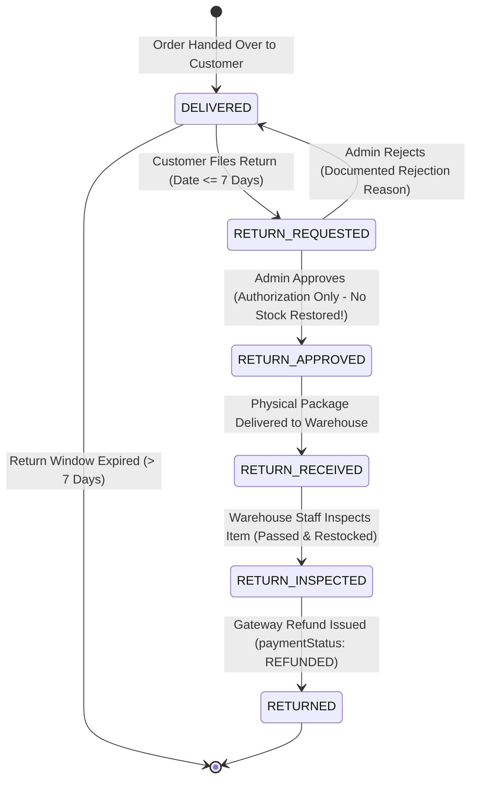

# Phase 7 Report: Customer Wallet, Append-Only Transaction Ledger, Razorpay Gateway Refunds & Return Architecture

**Milestone Completion Document**  
**Phase**: 07 — Customer Wallet, Append-Only Ledger, Gateway Refunds & Returns  
**Date**: September 2026  
**Status**: Fully Implemented, Tested, Documented & Verified  

---

## Part 1: Executive Summary & Milestone Deliverables

Phase 7 completes the financial stored-value, refund, and return architecture of the enterprise e-commerce platform. While Phase 6 established online payment initiation, signature verification, webhooks, and reservation hardening, Phase 7 delivers the customer-facing wallet ecosystem, an immutable append-only ledger, Razorpay gateway refunds against captured payments, administrative financial reconciliation, and the customer return request foundation with inventory restoration.

In accordance with strict architectural requirements, **Phase 7 enforces absolute separation between Gateway Refunds and Wallet Credits**:
1. Online payments paid via Razorpay (UPI, Cards, Netbanking) are refunded **directly back to the original payment method** via the Razorpay gateway refund API rails.
2. The Customer Wallet represents internal stored value, utilized exclusively for promotional rewards, goodwill compensation, and audited administrative adjustments.
3. Razorpay refunds never create wallet transactions; wallet credits never create Razorpay gateway refunds.

### Key Deliverables Completed:
1. **Payment Enum Reconciliation & Gateway State Mapping**:
   - Reconciled internal `Payment` enums with active implementation states (`CREATED`, `AUTHORIZED`, `CAPTURED`, `FAILED`, `CANCELLED`, `EXPIRED`, `REFUNDED`, `PARTIALLY_REFUNDED`).
   - Documented explicit mapping between Application Payment States and Razorpay Gateway States.
2. **Domain Model & Entity Separation**:
   - Explicitly decoupled `Order` (fulfillment contract), `Payment` (charge intake), `Refund` (gateway return of funds), `Wallet` (stored value), and `WalletTransaction` (immutable ledger).
3. **Customer Wallet & Append-Only Ledger (`backend/src/modules/wallet/`)**:
   - `Wallet`: Exactly one wallet per user (`userId` unique), non-negative balance invariant (`balance >= 0`), currency `INR`.
   - `WalletTransaction`: Append-only, immutable transaction ledger (`updatedAt: false`) with compound unique idempotency index on `{ referenceType: 1, referenceId: 1 }` preventing duplicate credits or debits.
   - `WalletService`: Atomic `getOrCreateWallet`, `creditWallet`, `debitWallet`, `getTransactions` (paginated), `adminCreditWallet`, and `adminDebitWallet` executed inside MongoDB multi-document ACID transactions.
   - Protected API routes: `/api/v1/wallet`, `/api/v1/wallet/transactions`, `/api/v1/admin/wallets/:userId/credit`, `/api/v1/admin/wallets/:userId/debit`.
4. **Razorpay Gateway Refunds & Reconciliation (`backend/src/modules/refunds/`)**:
   - `Refund`: Tracks `refundNumber`, `orderId`, `paymentId`, `userId`, `amount` (integer paise), `status` (`PENDING`, `PROCESSING`, `PROCESSED`, `FAILED`), `refundType` (`FULL`, `PARTIAL`), `gatewayPaymentId`, `gatewayRefundId`, and compound unique index `{ paymentId: 1, idempotencyKey: 1 }`.
   - `RefundService.createRefund`: Initiates gateway refund against captured payments, strictly enforcing that refund amount cannot exceed captured amount minus prior refunds, rejecting uncaptured/pending payments and COD orders.
   - **ADR-32 Refund Concurrency & Pre-Gateway Capacity Reservation**: Reserves refund capacity atomically on `Payment.committedRefundPaise` before contacting Razorpay. On gateway failure, releases capacity and marks refund `FAILED` for retry.
   - **ADR-29 Transaction Boundary Isolation**: Razorpay gateway refund network calls execute strictly outside database transactions. Short DB transactions handle initial PENDING state creation and subsequent PROCESSED state settlement.
   - `processRefundForCancelledOrder`: Settle Phase 6 `REFUND_REQUIRED` orders, transitioning `payment.reconciliationStatus` to `SETTLED`.
   - API routes: `POST /api/v1/refunds`, `GET /api/v1/refunds/order/:orderId`, `GET /api/v1/admin/refunds`, `POST /api/v1/admin/refunds/order/:orderId/settle`.
5. **Return Request Foundation & Inspection Gate (`backend/src/modules/orders/`)**:
   - `Order.returnRequest`: Subdocument tracking `status` (`NONE`, `REQUESTED`, `APPROVED`, `REJECTED`), `reason`, `requestedAt`, `reviewedAt`, `reviewedBy`, and `rejectionReason`.
   - 7-Day Return Window (`ORDER_RETURN_WINDOW_DAYS = 7`): Returns only permitted for `DELIVERED` orders within 7 calendar days of delivery.
   - **ADR-33 Return Inventory Timing & Inspection Gate**:
     - Approving a return transitions `orderStatus` to `RETURN_APPROVED` and sets `paymentStatus = "REFUND_PENDING"`. **Stock is NEVER restored upon return approval.**
     - Physical arrival at warehouse transitions order to `RETURN_RECEIVED` (`POST /api/v1/admin/orders/:id/return/receive`).
     - Warehouse inspection (`POST /api/v1/admin/orders/:id/return/inspect`) evaluates `inspectionPassed` and `restock`. Stock is restored **strictly if and only if** `inspectionPassed: true` AND `restock: true` AND `!order.inventoryRestored`. Damaged items do not restore sellable catalog stock.
     - Subsequent gateway refund settlement transitions the order to terminal `RETURNED`.
6. **Frontend Experience & User Interface**:
   - `WalletPage` (`/wallet`): Sleek dark/emerald hero card displaying real-time wallet balance, currency badge, security guarantee, and an append-only transaction history table with pagination. Presentation conversion divides paise by 100 strictly at the UI boundary.
   - `OrdersPage` (`/orders`): Added refund badges (`Refund Required`, `Refund Processing`, `Refunded`, `Partially Refunded`), return state badges (`Return Requested`, `Return Approved`, `Return Received`, `Return Inspected`, `Return Rejected`, `Returned`), and an interactive "↩ Request Return" modal dialog for eligible delivered orders.
   - `Navbar`: Added navigation link to `/wallet` with auth-state visibility.
7. **Comprehensive Test Suites**:
   - `backend/tests/wallet.test.js`: 14 integration tests covering auto-creation, unique constraint, atomic credits/debits in integer paise, insufficient balance rejection, schema non-negative invariant, duplicate reference idempotency, paginated history, Anti-IDOR, admin adjustments, security role guards, and the mathematical balance consistency equation ($\text{balance} = \sum \text{credits} - \sum \text{debits}$).
   - `backend/tests/refund.test.js`: 11 integration tests covering full refunds in paise, explicit money unit conversions, role authorization enforcement (403), concurrent refund race protection (one 201, one 400), gateway 504 failure and retry, idempotency keys, return lifecycle & inventory timing (approve $\rightarrow$ receive $\rightarrow$ inspect $\rightarrow$ stock restored), damaged return inspection without stock restoration, and architectural separation verification.
   - Full test run: **16 test files, 170 tests passed, 0 failures**.
   - Frontend build: Vite production build completes in **2.12s** with zero errors.

---

## Part 2: Architecture & Data Contracts

### 2.1 Domain Separation Matrix

| Domain Model | Primary Responsibility | Key Fields | Storage Collection |
| :--- | :--- | :--- | :--- |
| **Order** | What the customer purchased, delivery destination, and physical fulfillment state. | `orderNumber`, `items`, `shippingAddress`, `priceSummary`, `orderStatus`, `paymentStatus`, `returnRequest`, `inventoryRestored`, `inspectionDetails` | `orders` |
| **Payment** | How the order was paid via the gateway, banking charge state, committed refund capacity in paise, and reconciliation flags. | `gatewayOrderId`, `gatewayPaymentId`, `amount` (paise), `committedRefundPaise` (paise), `status`, `reconciliationStatus` | `payments` |
| **Refund** | Money returned to customer against a captured online payment via gateway rails. | `refundNumber`, `orderId`, `paymentId`, `amount` (paise), `status`, `refundType`, `gatewayRefundId`, `idempotencyKey` | `refunds` |
| **Wallet** | Customer's internal stored-value account balance for promotional rewards and goodwill. | `userId`, `balance` (paise), `currency` | `wallets` |
| **WalletTransaction** | Immutable append-only journal tracking every balance credit or debit. | `walletId`, `userId`, `type`, `amount` (paise), `balanceBefore`, `balanceAfter`, `referenceType`, `referenceId` | `wallettransactions` |

---

### 2.2 Payment Enum Reconciliation & Gateway Mapping

| Razorpay Gateway State | Internal Payment State | Semantic Meaning in System |
| :--- | :--- | :--- |
| `created` | `CREATED` | Gateway order created; client modal opened but not authorized. |
| `authorized` / `captured` | `CAPTURED` | In our auto-capture architecture, authorized payments are captured immediately. Terminal for intake. |
| `failed` | `FAILED` | Gateway declined payment (bank decline, wrong OTP, card network timeout). |
| `refunded` (full) | `REFUNDED` | Entire captured amount refunded back to original funding source. |
| `refunded` (partial) | `PARTIALLY_REFUNDED` | Portion of captured amount refunded; balance remaining can still be refunded up to cap. |
| *App Internal* | `EXPIRED` | 15-minute payment reservation window elapsed; inventory released by sweeper. |
| *App Internal* | `CANCELLED` | Customer or merchant cancelled order prior to payment completion. |

---

### 2.3 ADR-29 & ADR-32: Gateway Refund Boundary Isolation & Capacity Reservation

```mermaid
sequenceDiagram
    autonumber
    actor Admin as Admin / System
    participant Service as RefundService
    participant DB as MongoDB
    participant Razorpay as Razorpay API

    Admin->>Service: POST /api/v1/refunds { orderId, amount, reason, idempotencyKey }
    Service->>DB: 1. Validate Order, anti-IDOR, reject COD, find CAPTURED payment
    Service->>DB: 2. Check Idempotency (paymentId + idempotencyKey)
    Service->>DB: 3. Atomic Conditional Capacity Reservation (ADR-32):<br/>findOneAndUpdate(committedRefundPaise + requested <= amount, inc: +requested)
    alt Capacity Exceeded / Concurrent Race
        Service-->>Admin: 400 Bad Request (Exceeds captured payment capacity)
    else Capacity Reserved
        Service->>DB: 4. Step A: Insert Refund doc (status: "PENDING")
        Note over Service,Razorpay: Step B: External Network Call OUTSIDE DB Transaction (ADR-29)
        Service->>Razorpay: POST /payments/{id}/refund { amount: paise }
        alt Gateway Call Succeeds
            Razorpay-->>Service: Return { id: "rfnd_K9x..." }
            Note over Service,DB: Step C: Short ACID DB Transaction (< 10ms)
            Service->>DB: 1. Refund.status = PROCESSED, gatewayRefundId = "rfnd_K9x..."<br/>2. Payment.status = REFUNDED / PARTIALLY_REFUNDED<br/>3. If REFUND_REQUIRED -> payment.reconciliationStatus = SETTLED<br/>4. Order.paymentStatus = REFUNDED / PARTIALLY_REFUNDED<br/>5. If RETURN_INSPECTED -> orderStatus = RETURNED
            Service-->>Admin: 201 Created { refund, payment, order }
        else Gateway Call Fails (Timeout / Network Error)
            Razorpay-->>Service: 504 Gateway Timeout
            Service->>DB: 1. Atomically release capacity: inc committedRefundPaise: -requested<br/>2. Mark Refund.status = "FAILED", failureReason = "504 Gateway Timeout"
            Note over DB: Capacity released; client can safely retry!
            Service-->>Admin: 500 Internal Server Error
        end
    end
```

---

### 2.4 Multi-Stage Return Lifecycle & ADR-33 Inventory Timing



---

## Part 3: Test Verification Evidence

### 3.1 Backend Full Test Suite Execution (`npm test`)
```
 RUN  v3.2.7 C:/Users/vines/react first project/backend

 ✓ tests/auth.test.js (22 tests) 8140ms
 ✓ tests/refund.test.js (11 tests) 2830ms
 ✓ tests/order.test.js (11 tests) 2761ms
 ✓ tests/wallet.test.js (14 tests) 2415ms
 ✓ tests/payment.test.js (17 tests) 2224ms
 ✓ tests/product.test.js (22 tests) 1804ms
 ✓ tests/address.test.js (14 tests) 1761ms
 ✓ tests/offer.test.js (6 tests) 1652ms
 ✓ tests/category.test.js (6 tests) 1664ms
 ✓ tests/coupon.test.js (9 tests) 1704ms
 ✓ tests/brand.test.js (5 tests) 1674ms
 ✓ tests/cart.test.js (14 tests) 1153ms
 ✓ tests/checkout.test.js (4 tests) 1017ms
 ✓ tests/wishlist.test.js (8 tests) 1003ms
 ✓ tests/concurrency.test.js (4 tests) 109ms
 ✓ tests/health.test.js (3 tests) 41ms

 Test Files  16 passed (16)
      Tests  170 passed (170)
   Duration  62.90s
```

### 3.2 Frontend Production Build (`npm run build`)
```
vite v8.3.0 building client environment for production...
transforming...
✓ 1682 modules transformed.
rendering chunks...
computing gzip size...
dist/index.html                   0.93 kB │ gzip:   0.52 kB
dist/assets/index-fp3hLHkS.css   36.59 kB │ gzip:   6.85 kB
dist/assets/index-CbwbBQ39.js   556.36 kB │ gzip: 152.62 kB

✓ built in 2.12s
```

---

## Part 4: Phase 8 Strict Boundary Declaration

In accordance with architectural planning and user instructions, **Phase 7 Final Hardening is fully completed and all work has stopped**.
- No Phase 8 features or files have been created.
- Awaiting user review and authorization before commencing any Phase 8 scope.

